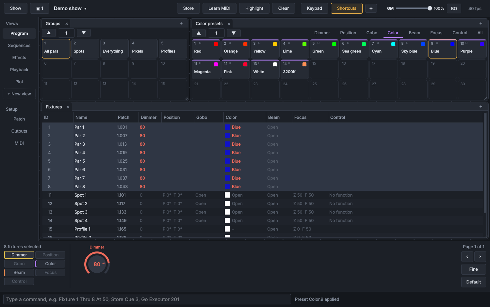

# Lumora

A free, open source lighting console for Linux, macOS and Windows. Fixtures, groups and presets live in pools, cues are built from blueprints, and sequences play back on executors. Two things are different on purpose:

- **MIDI learn on every executor.** Turn on *Learn MIDI*, click a fader or button, move a control on your MIDI device, done. OSC works too, with full feedback for tablets and a [Bitfocus Companion module](https://github.com/typoirl/companion-module-lumora-console).
- **A cleaner interface.** One screen per job, color used only where it means something, and executor faders that glow with what's actually on stage.



Current version: **a.7.2.2** (alpha). Builds go on the [Releases](https://github.com/typoirl/Lumora/releases) page, and news is on [Discord](https://discord.gg/m2SY5fsR9p).

## User guide

**[docs/Lumora-Manual.pdf](docs/Lumora-Manual.pdf)** covers everything: a first show step by step, a chapter for every window, a command line reference and a glossary. In Lumora, **F1** opens the same guide with a search.

## Features

- **Fixtures**: GDTF, Open Fixture Library and QLC+ files, plus a built-in library (generic types, Chauvet DJ and Professional, media and laser servers) and a browser for GDTF Share, OFL and QLC+. Pixel and multi-head fixtures as subfixtures (101.1), pan and tilt in degrees, a fixture editor.
- **Programming**: a plain-English command line, encoders with an XY pad and framing shutters, a color picker with gels and a gamut, layered presets (Universal, Global, Selective), a preset builder, programmer fade, park, highlight, and undo.
- **Selection matrix**: lay the selection out in X and Y; spreads and effects run across it, down it or both.
- **Effects**: layered waves, steps and shapes, laid out by spreads, stored in presets and cues, with ten BPM, ratio and rate masters.
- **Cues and playback**: tracking cue lists built from blueprints (group + presets + spread), individual fade and delay times, cue triggers and macros, priorities, up to 99 executors per row with Go, GoBack, Off, Flash, Temp, Goto and more.
- **Workspace**: views of windows on a grid, up to six screens, plots of the rig with live intensity and color, a playback monitor and macros.
- **Control**: MIDI learn with pickup and motor/LED feedback; OSC over UDP or TCP.
- **Output**: Art-Net and sACN (up to 2048 universes), Enttec DMX USB Pro and Open DMX.
- **Shows**: one file with its fixture types inside, so a show opens on any computer.

On first launch Lumora opens a **demo show**: 8 moving washes, 4 profiles, 8 pixel bars and 4 blinders, with groups, presets, effects and four cue lists on executors 201–204. Press **Go** on 201 to start it.

## Building

You need CMake 3.21+, a C++17 compiler and Qt 6.2 or newer (Widgets, Svg, Network, SerialPort, Test).

```sh
# Linux (Debian/Ubuntu)
sudo apt install build-essential cmake ninja-build qt6-base-dev qt6-svg-dev qt6-serialport-dev libasound2-dev
cmake -S . -B build -G Ninja -DCMAKE_BUILD_TYPE=Release
cmake --build build && ./build/lumora

# macOS
brew install cmake ninja qt
cmake -S . -B build -G Ninja -DCMAKE_PREFIX_PATH="$(brew --prefix qt)"
cmake --build build && open build/lumora.app
```

On **Windows**, install Qt 6 (with Qt SVG and Serial Port) and build from a Qt command prompt with `cmake -S . -B build -DCMAKE_PREFIX_PATH=C:\Qt\<version>\mingw_64` and `cmake --build build --config Release`.

Run the tests with `ctest --test-dir build`. The user guide is written in `docs/manual/manual.md`; `python3 docs/manual/build_manual.py` rebuilds the PDF (it needs `reportlab`). The Windows installer files come with the release zips rather than this repository.

## Project layout

```
src/core/     show model, engine, outputs, MIDI, OSC, command line (no GUI)
src/ui/       the Qt Widgets application
tests/        unit tests for the core
fixtures/     the built-in fixture library
docs/         the user guide and its source
third_party/  RtMidi and stb_image
```

## Roadmap

GDTF DMX breaks, effects that track through cues, timecode, a 3D visualizer, and pixel mapping media onto cells.

## Contributing

Issues and pull requests are welcome. Please cover core changes with tests in `tests/test_core.cpp`, and keep the interface quiet: new color should mean something.

## License

GPL-3.0-or-later. See [LICENSE](LICENSE). RtMidi (MIT-style) and stb_image (public domain / MIT) keep their own licenses in `third_party/`.
