# Getting started

## Welcome to Lumora {#welcome}

Lumora is a lighting console for Windows: patch your rig, build looks in the programmer, store them as cues and play them back on executors, over Art-Net, sACN or a USB DMX interface.

This guide assumes you know lighting and DMX, but not any particular console.

- **New to Lumora?** Read [How Lumora works](#basics), then follow [Your first show](#first-show) step by step. Terms are explained where they first appear, and again in the [Glossary](#glossary).
- **Looking something up?** The [Command line reference](#command-reference) and [Keyboard shortcuts](#shortcuts) chapters are the quick references.

### How this guide is organized

1. **Getting started**: how Lumora works, installing and updating it, a tour of the screen, and a complete first show.
2. **Setting up**: patching fixtures, fixture types, subfixtures (pixels and multi-head fixtures), outputs, MIDI and OSC.
3. **Programming**: selecting fixtures, the programmer, encoders, color, groups, presets, spreads and effects.
4. **Cues and playback**: sequences, cues, blueprints, executors, and watching a show run.
5. **The workspace**: views, windows, screens, and the windows you can add.
6. **Reference**: the command line, shortcuts, show files, troubleshooting and a glossary.

Every entry in the table of contents is a link: click it to jump to that chapter. Links inside the text work the same way.

> **Tip:** Lumora opens with a ready-made *demo show* the first time you start it. It has lights, groups, presets and cues already made, so you can try anything in this guide on it without breaking anything you care about. **Show → New demo show** brings it back at any time.

### Conventions

- **Bold** words are buttons, menu items and window names you can click, such as **Store** or **Show → Save**.
- `Monospaced` text is something you type on the command line, such as `Fixture 1 Thru 4 At 50`. Press **Enter** after it.
- Keyboard keys are written like **Esc** or **Shift+A**.
- *Tap* means click with the mouse or touch on a touch screen.

## How Lumora works {#basics}

A few ideas everything else in Lumora is built on.

### Features and attributes

Every controllable thing on a fixture is an **attribute** (Dimmer, Pan, Red, Gobo1, Zoom…). Attributes are grouped into seven **features**, which is how the encoders, presets and the fixture sheet are organized:

| Feature | What it covers |
| --- | --- |
| **Dimmer** | Intensity: how bright the light is. |
| **Position** | Where a moving light points: pan (left/right) and tilt (up/down). |
| **Gobo** | Gobo wheels: patterns that shape the beam. |
| **Color** | Color mixing (red, green, blue, white, amber, cyan, magenta, yellow…), color wheels and color temperature. |
| **Beam** | Shutter and strobe, iris, prism, frost. |
| **Focus** | Zoom and focus. |
| **Control** | Lamp on/off, reset, fans, built-in macros. |

### IDs and addresses

Every fixture has an **ID**, the number you select it by (`Fixture 11`), independent of its DMX address. Pixels and heads of a fixture are **subfixtures** with IDs like 101.1 (see [Subfixtures](#subfixtures)). Addresses are written *universe.address*: `2.051` is universe 2, channel 51. Lumora reads fixture types from GDTF, Open Fixture Library and QLC+ files (see [Fixture types](#fixture-types)).

### The programmer, presets and cues

Working a console has three layers:

1. **The programmer** is your scratch pad. You select fixtures and set their values; what's in the programmer goes straight to the stage, on top of everything else, until you clear it.
2. **Presets** are named values you reuse: "Red", "Downstage center", "Star gobo". Presets are referenced, not copied, so when you change a preset every cue that uses it changes too.
3. **Cues** are stored looks. A list of cues is a **sequence**. During the show you press **Go** to move from one cue to the next, with smooth fades.

Sequences play back on **executors**: on-screen faders and buttons (and real ones, if you connect a MIDI controller).

### Tracking

Lumora sequences **track** by default. A cue only stores what *changed*. If cue 1 turns the stage blue and cue 2 only raises the backlight, the stage stays blue in cue 2 because the blue *tracks* through. This makes editing easy: change the color in cue 1 and every following cue that didn't change the color follows along. You can switch tracking off per sequence.

### Precedence: who wins when two things control the same light

When several sequences play at once, each sequence's **priority** decides (see [Priority](#priority)):

- **By default everything is LTP (latest takes precedence), intensity included**. The sequence that went most recently wins, for intensity, color, position and the rest.
- **A higher priority always wins:** Low, then LTP, then HTP, then Ultra. Among **HTP** sequences intensity is highest takes precedence (40% and 70% make 70%).
- **The programmer wins over every sequence except Ultra ones.**
- A sequence whose values have all been taken over by others **turns itself off** (Off when overridden), so ten color sequences replace each other instead of piling up.

## Installing and starting Lumora {#install}

### Installing

Lumora comes as a Windows installer, `Lumora-<version>-win64.msi`.

1. Double-click the `.msi` file.
2. If Windows says it "protected your PC", click **More info**, then **Run anyway**. (The installer isn't signed by a known publisher yet.)
3. Accept the license, keep or change the install folder, and click **Install**. Windows asks for permission to install.
4. Start Lumora from the **Lumora** shortcut on the desktop or in the Start menu.

Lumora installs into *Program Files\Lumora*. The Start menu also has **Lumora User Guide**, which opens this guide. Show files (`.lumora`) open in Lumora when you double-click them, with Lumora's icon.

> **Note:** The first time Lumora sends Art-Net or sACN, Windows Firewall may ask whether to allow it on your networks. Allow it on the network your DMX nodes are on, or nothing reaches them.

### Updating

Run the installer for the new version. It replaces the old version in place: there's no need to uninstall first. Your shows, settings (outputs, interface, MIDI mappings) and downloaded fixture types are kept, because they live in your own user folders rather than in Program Files.

Check which version you have under **Show → User guide** (the cover page) or in Windows' **Settings → Apps → Installed apps**.

### Uninstalling

Open Windows' **Settings → Apps → Installed apps**, find **Lumora**, and choose **Uninstall**. Your show files are left where you saved them.

### First launch

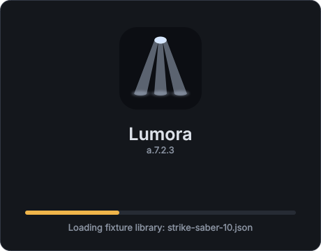

While Lumora starts, a loading screen shows its progress and, under the bar, what it's loading right now: the fixture library a file at a time, then the show and the screens that were open.

The first time it starts, Lumora opens the **demo show**: eight moving washes, four profiles, eight pixel bars and four two-cell blinders, with groups, presets (some carrying effects), effects and four cue lists on executors 201–204: one each for the washes, the profiles and the pixel bars, and a Temp key for the blinders. Go to the **Playback** view and press **Go** on 201 to see it run. See [The demo show](#demo-show).

After that, Lumora reopens the last show you used.

### Opening the guide

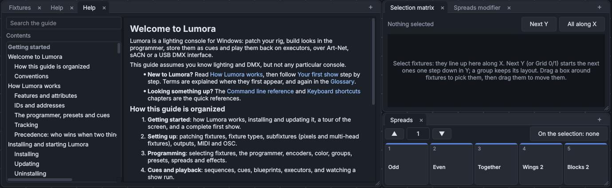

**F1** (or **Show → Help**) opens this guide inside Lumora, with a search: type a word and the sections that mention it are listed, with the word highlighted. **+ → Help** puts it in a window of a view. **Show → User guide (PDF)** opens it as a PDF, and so does **Lumora User Guide** in the Start menu.

## A tour of the screen {#tour}

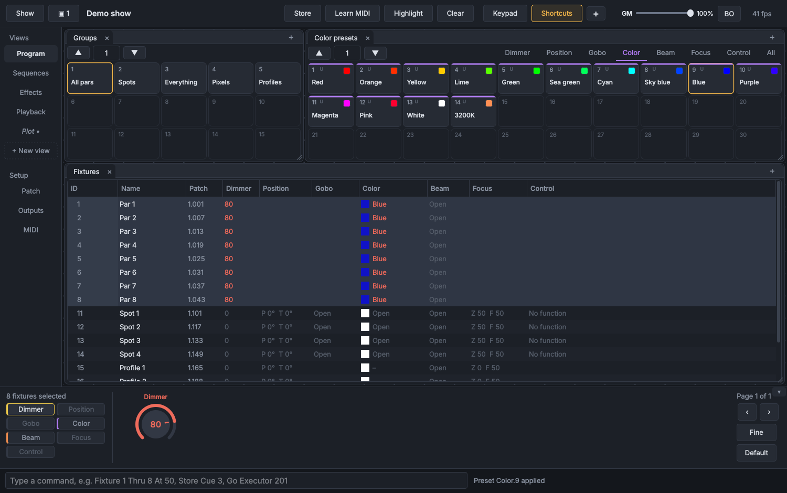

The Lumora window has six areas.

### The top bar

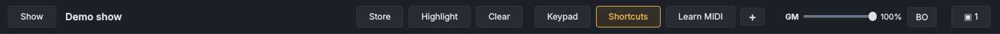

From left to right:

- **Show**: the show menu (new, open, save, views, the preset builder, Config, the user guide, quit).
- **The show name**: the name of its file, so it changes when you **Save as…** under a new name. A dot after it means there are unsaved changes.
- **Store**: arms Store. The next thing you tap (or type) is where something gets stored. See [Storing](#storing).
- **Highlight**: makes the selected fixtures bright and open so you can see which lights they are.
- **Clear**: clears the selection, then (pressed again) the programmer.
- **Keypad**: floats the on-screen command keys over the window.
- **Shortcuts**: turns keyboard shortcuts on and off (lit when on).
- **Learn MIDI**: maps controls on a MIDI controller to on-screen faders and buttons. See [MIDI](#midi).
- **+**: adds a window to the current view.
- **GM**: the grand master, which scales all intensity. **BO** is blackout. Both pulse while they hold the output down.
- **▣ 1**, at the far right: screens. Open more Lumora windows for other monitors; see [Screens](#screens).

### The rail

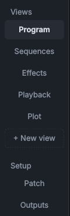

The column on the left lists the show's **views**: saved screen layouts such as Program, Sequences, Effects, Playback and Plot. Tap one to switch. **+ New view** makes another. Below them, **Setup** has **Patch**, **Outputs** and **Control** (MIDI and OSC). See [Views and windows](#views).

### The windows

The big area in the middle shows the windows of the current view: pools of groups and presets, the fixture sheet, cue lists, executors and so on. Windows can be moved, resized, stacked as tabs and given options (right-click a window's tab).

### The encoder bar

The strip along the bottom is the **encoder bar**: virtual knobs for the selected fixtures' attributes, organized by feature. It's on the main screen (screen 1) only; other screens use that space for more window grid. The small arrow in its top-right corner tucks it away to a thin strip (and brings it back), and an **Encoders** window (**+ → Encoders**) puts encoders anywhere else. See [Encoders](#encoders).

### The command line

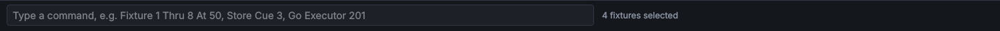

The bottom line is the **command line**. Type commands such as `Fixture 1 Thru 4 At Full` and press **Enter**. The area to its right shows what the last command did. Everything you can do with the mouse you can also type; see the [Command line reference](#command-reference).

### Right-click to edit

Almost anything you can change opens a small editor when you right-click it: a pool tile opens with its name ready to type plus its actions, an encoder opens its value and named ranges, a cell in a table starts editing. When in doubt, right-click.

## The demo show {#demo-show}

The demo show is a small rig with everything already made, to try things on.

| Fixtures | IDs | Group | Cue list |
| --- | --- | --- | --- |
| 8 moving washes (RGBW, zoom) | 1–8 | 1 Washes | 201 **Washes** |
| 4 profiles (framing shutters, gobos, prism, frost) | 11–14 | 2 Profiles | 202 **Profiles** |
| 8 pixel bars of 8 cells | 21–28 (cells 21.1–28.8) | 3 Pixel bars, an 8 × 8 [selection matrix](#selection-matrix) | 203 **Pixel bars** |
| 4 two-cell blinders | 31–34 (cells 31.1–34.2) | 4 Blinders, 4 × 2 | 204 **Blinders**: hold its **Temp** key |

Group 5, **Movers**, is the washes and profiles together.

- **The cue lists** run on the faders 201–204, whose keys are **Go**, **GoBack** and **Off**. The blinders' executor has only a **Temp** key: hold it and they come on with a random strobe; let go and they fall away over 0.7 seconds (the cue list's Off fade).
- **Blueprint lines**: every cue is built from lines of a group and presets, and the presets that carry effects are all in use: Dimmer **Chase** and **Breathe**, Color **Rainbow** and **Color swap**, Position **Circle** and **Ballyhoo**, Focus **Zoom breathe** and All **Random strobe**. Several lines lay them out with a spread: Odd and Even split the washes red and orange, Wings 2 mirrors the rainbow circle, Middle out sends the chase from the center, Blocks 2 pairs the breathing, and Alternate bars takes every other pixel bar.
- **Presets**: the standard colors and 3200K, Center, Audience and Fan positions, five gobos, prism and frost for the profiles, and zoom wide and narrow for the washes.
- **The Program view** has the groups and presets along the top, the fixture sheet with this guide beside it as a tab, the selection matrix (with the spreads modifier as a tab) and the spreads pool.
- **The Rig plot** shows the whole rig live, with groups, colors, executors and macros to tap.

## Your first show {#first-show}

This tutorial takes you from an empty show to a short cue list you can play back. It uses fixtures from Lumora's built-in library, so you can follow it without any lights connected: the fixture sheet and DMX monitor show what would be sent.

### Step 1: Start a new show

1. Tap **Show → New show**. Lumora asks whether to save the current show if it has changes.
2. The new show has five empty views (Program, Sequences, Effects, Playback, Plot) and no fixtures.
3. Tap **Show → Save as…** and give it a name, so you can save as you go with **Show → Save** (or **Ctrl+S**).

### Step 2: Patch some fixtures

You'll add four RGBW LED pars and two moving spots.

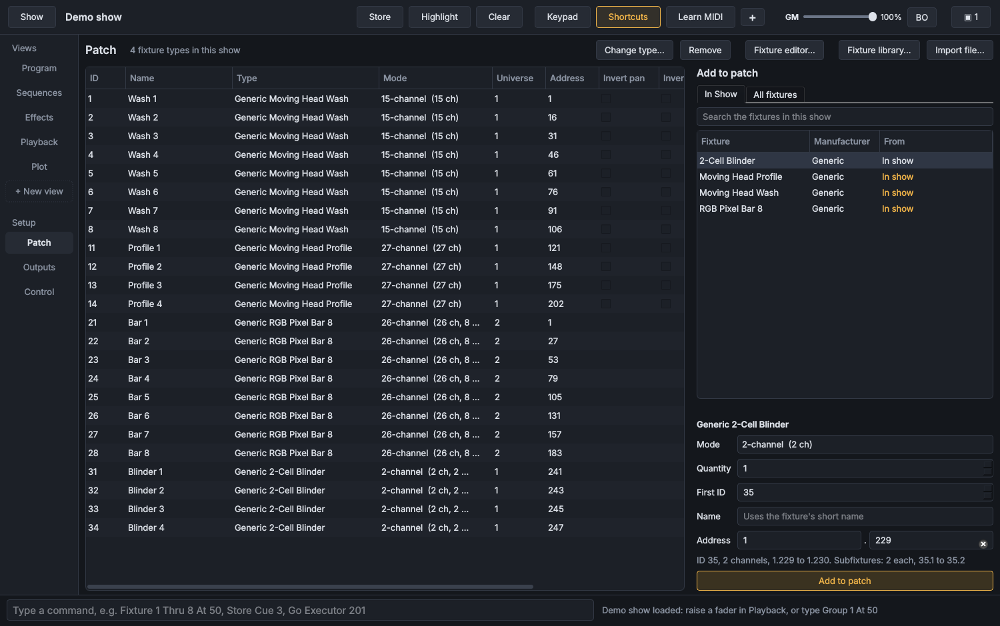

1. Tap **Patch** in the rail.
2. In **Add to patch** on the right, type `RGBW` in the search box and tap **RGBW LED Par** in the list.
3. Set **Mode** to *6-channel*, **Quantity** to 4 and **First ID** to 1. Leave **Name** empty (the fixtures will be called Par 1, Par 2…).
4. **Address** shows `1` (universe) and the next free address. Leave it.
5. Read the summary line: "IDs 1–4, 6 channels each, 1.001 to 1.024". Tap **Add to patch**.
6. Search for `Moving Head Spot`, pick it, choose the *16-channel* mode, Quantity 2, First ID 11, and tap **Add to patch**. Lumora fills in the next free address (1.025).

The patch table on the left now lists your six fixtures with their IDs, types, modes and addresses.

> **Tip:** The **ID** is the number you use to talk to a fixture (`Fixture 11`). It's independent from the DMX address, so you can number fixtures in a way that makes sense on stage (say 1–10 for front light, 21–30 for back light) whatever their addresses.

### Step 3: Check the output

1. Tap **Outputs** in the rail. Universe 1 already has an output: Lumora adds one for every universe you patch, sending Art-Net on any network card.
2. If you have a network DMX node, set its network card under **Network interface**, and make sure the node listens to the same Art-Net universe (the **Sent as** column). See [Outputs](#outputs).
3. The **DMX monitor** at the bottom shows the 512 channels of the universe. Keep it in mind: it's the best way to check that Lumora is sending what you expect.

### Step 4: Select fixtures and set intensity

1. Tap **Program** in the rail.
2. Tap in the command line, type `Fixture 1 Thru 4` and press **Enter**. The four pars highlight in the fixture sheet and the encoder bar shows "4 fixtures selected".
3. Type `At 75` and press **Enter**. The pars go to 75%. In the fixture sheet their Dimmer column reads 75 in coral: coral means *in the programmer*.
4. Try the encoder: drag the **Dimmer** knob up or down, or scroll over it.

You can also select by tapping rows in the fixture sheet. Selections **add up**: tapping another row (or typing another fixture) adds it to what's already selected. Press **Clear** (or **Esc**) to start a new selection.

### Step 5: Make a group

A group is a saved selection, so you don't have to type the fixture numbers every time.

1. With fixtures 1–4 selected, press **Store** in the top bar. The empty slots in the pools light up.
2. Tap slot 1 in the **Groups** pool. The group is stored.
3. Right-click the new tile, type `Pars` in **Name** and press **Enter**.
4. Press **Clear**, select the spots with `Fixture 11 Thru 12`, press **Store** and tap group slot 2. Name it `Spots`.

Now tapping the **Pars** tile selects the four pars.

### Step 6: Make color presets

1. Tap the **Pars** group (clear first if anything else is selected).
2. Make sure the Color tab of the presets pool is showing (tabs along its top: Dimmer, Position, Gobo, Color…).
3. Tap the **Color** button in the encoder bar and set **Red** to 100, **Green** to 0, **Blue** to 0 and **White** to 0 (drag the knobs, or double-click one to type a value).
4. Press **Store** and tap an empty slot in the Color presets pool. Right-click it and name it `My red`.
5. Set the encoders to blue (Red 0, Green 0, Blue 100) and store another preset, `My blue`.

The new preset tiles show a color swatch. Tapping a preset tile applies it to the selected fixtures.

> **Tip:** Picking a color in the [color picker](#color) instead (a gel, a standard color or a color temperature) and then storing names the preset for you, for example "Red" or "L201 Full CT Blue".

> **Note:** New shows don't come with color presets, but the demo show does: the thirteen standard colors plus a 3200K warm white in the Color pool. Using a preset rather than raw values in cues means you can later change "My red" once and every cue follows.

### Step 7: Store your first cue

1. Press **Clear** twice (once clears the selection, the second time empties the programmer).
2. Tap **Pars**, type `At 80` and press **Enter**, then tap **My blue**.
3. Press **Store**. The executor tiles appear along the bottom (the encoder bar's place) because this view has no executors.
4. Tap executor **201**. Lumora makes a new sequence, stores cue 1 in it and assigns it to executor 201.
5. Press **Clear** twice.

### Step 8: Store more cues

1. Tap **Pars** and **My red**. Tap **Spots**, type `At Full`.
2. Press **Store** and tap executor 201 again. Its sequence has one cue, so Lumora asks what to do: tap **Add Cue 2**. (With two or more cues it stores the next one straight away.)
3. Clear twice. Tap **Pars**, type `At 0`. Store onto 201 again: cue 3 takes the pars out but leaves the spots up (tracking).
4. Clear twice.

### Step 9: Play it back

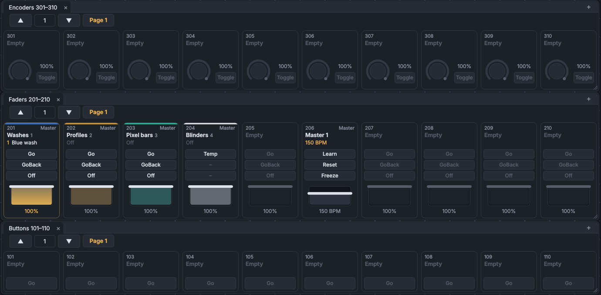

1. Tap **Playback** in the rail. Executor 201 shows your sequence.
2. Raise fader 201 (drag it up). Raising a fader from zero starts its sequence at cue 1.
3. Press **Go** on executor 201 to move to cue 2, and again for cue 3. Each cue fades in over its fade time (2 seconds unless you change it).
4. **GoBack** goes to the previous cue. Other key functions (**Pause**, **Flash**, **Temp**…) are a right-click away: see [Button functions](#button-functions).
5. Pull the fader down to stop the sequence.

### Step 10: Adjust the cues

1. Tap **Sequences** in the rail. The sequence pool is on the left and its cues on the right.
2. Double-click a cue's **Name** cell and type a name, such as `Blue look`.
3. Double-click the **Fade** cell of cue 2 and type `5` for a five-second fade.
4. Save the show with **Show → Save**.

You've patched fixtures, made groups and presets, stored cues and played them back. The rest of this guide explains each part in depth.

# Setting up

## Patch {#patch}


The Patch screen (**Patch** in the rail) lists every fixture in the show on the left and has **Add to patch** on the right.

### The patch table

| Column | What it is | How to change it |
| --- | --- | --- |
| **ID** | The fixture's number, used to select it. | Right-click → give it a new ID. With several fixtures selected they're numbered on from the ID you type. Groups, presets and cues follow. |
| **Name** | A name for your own use. | Double-click to edit. Select several and right-click a name to rename them all at once, numbered in ID order. |
| **Type** | The fixture type. | Double-click or right-click → **Change type or mode…** |
| **Universe**, **Address** | Where it sits in DMX. | Type a new value. Clear either to unpatch the fixture. |
| **Invert pan**, **Invert tilt** | For fixtures hung the other way round. | Tick or untick; applies to every selected fixture. |

### Adding fixtures

**Add to patch** has two tabs:

- **In Show**: the fixture types this show already has (patched, imported, downloaded or edited). This is where to add more of what you have.
- **All fixtures**: one search over every fixture Lumora can get: the ones built into Lumora, GDTF Share, the Open Fixture Library and QLC+. **All sources** limits it to one of them (**Built in** for Lumora's own). Nothing here is in the show until you patch it, so a show only carries the types it uses.

A new show starts on **All fixtures**; once it has fixtures, **In Show**. The header above the patch says how many types the show holds.

1. Type part of the fixture's name or manufacturer in the search box.
2. Tap the fixture. If it isn't downloaded yet, Lumora gets it.
3. Choose the **Mode**, the **Quantity**, the **First ID** and a **Name** (optional).
4. **Address** has the universe and the start address. Lumora fills in the next free address. Clear the address field to add the fixtures *unpatched* (see below).
5. Check the summary line, then tap **Add to patch**.

**Naming.** A name ending in a number counts on from it: "Spot 5" adds Spot 5, Spot 6, Spot 7… A name without a number starts at 1. An empty name uses the fixture type's short name.

**Addresses never straddle universes.** Fixtures are laid out one after another from the start address, skipping addresses other fixtures already use. When the next fixture doesn't fit in what's left of a universe, it starts the next universe at address 1. The summary says where the fixtures will end up, including when they carry on into the next universe.

### Unpatched fixtures

A fixture can be in the show without a DMX address. You can select it, store groups, presets and cues with it, and program the whole show before the rig is hung; it just doesn't output. To patch it later, type an address in the table, or right-click its Universe or Address cell and choose **Patch** (sequentially from the next free address in a universe). To unpatch, clear its address or right-click → **Unpatch** (with several fixtures selected, they all unpatch).

### Changing a fixture's type or mode

Select one or more fixtures and press **Change type…** (or right-click a fixture's type). Search for the new type, pick the mode, and optionally re-address them sequentially from a start address. Values for attributes the new type shares are kept in presets and cues.

### Removing fixtures

Select them and press **Remove**. They disappear from groups, presets, cues and the programmer.

### Invert pan and tilt

A moving head hung upside down, or turned round, moves the opposite way. Tick **Invert pan** or **Invert tilt** and the DMX for that axis runs backwards. You keep programming in the same degrees, so presets work on every fixture.

### The fixture library and fixture files

- **Fixture library…** browses GDTF Share, the Open Fixture Library and QLC+, and imports fixture types into the show. See [Fixture types](#fixture-types).
- **Import file…** loads a GDTF (`.gdtf`), Open Fixture Library (`.json`), QLC+ (`.qxf`) or Lumora (`.lft`) file into the show.
- **Fixture editor…** builds a new fixture type or edits one. See [The fixture editor](#fixture-editor).

## Fixture types {#fixture-types}

A fixture type describes a fixture: its manufacturer and name, its modes, and for each mode its channels. Every type a show uses is saved inside the show file, so a show opens the same on any computer.

### Where fixture types come from

| Source | What it is |
| --- | --- |
| **GDTF Share** | The official GDTF library, mostly written by the manufacturers. Needs a free account at gdtf-share.com. |
| **Open Fixture Library** | A community library at open-fixture-library.org. |
| **QLC+** | The fixture definitions from the QLC+ project, with gobo images. |
| **Built in** | The fixture types that come with Lumora (the `fixtures` folder next to it): generic fixtures, the Chauvet DJ and Chauvet Professional ranges, and media and laser servers. |
| **Your own** | Types built in the fixture editor. |

### The Fixture library window

**Patch → Fixture library…** opens a browser for Lumora's own fixtures and all three online libraries.

1. Choose a source tab: **Built in**, **GDTF Share**, **Open Fixture Library** or **QLC+**.
2. Fixtures are grouped by manufacturer. Open a manufacturer with the arrow beside it to see its fixtures. As soon as you type in the search box, every manufacturer with a match opens, showing only the matches ("6 of 43 fixtures"); clear the search and they close again. The manufacturer list on the right narrows to one maker. Fixtures already in your library are marked *In library*.
3. Select one or many and press **Import**.

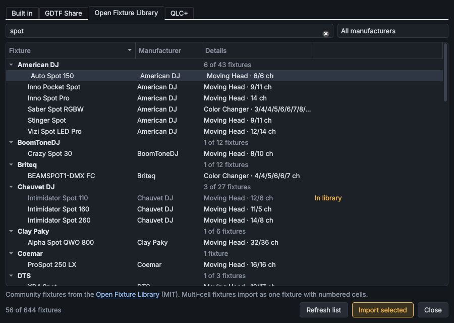

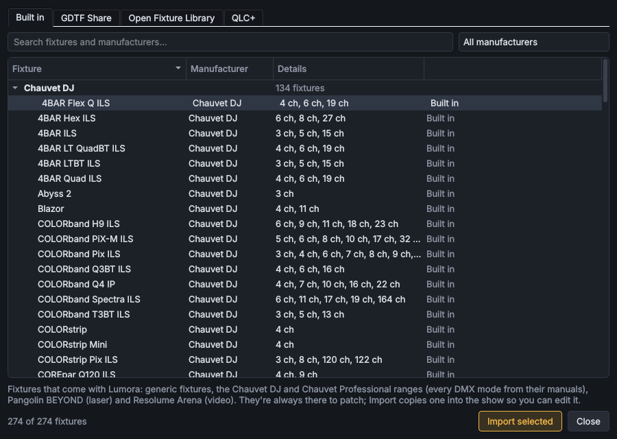

**Built in** lists the fixture types that come with Lumora: generic dimmers, pars, a pixel bar, a two-cell blinder, a moving spot, a moving wash and a profile with framing shutters, gobos, prism and frost; the **Chauvet DJ** (134) and **Chauvet Professional** (126) ranges, with every DMX mode charted in their manuals and, for 25 of the moving heads, the gobo pictures from Chauvet's own GDTF files on the wheel slots; and media and laser servers:

| Fixture | Modes | Notes |
| --- | --- | --- |
| **Pangolin BEYOND DMX Server (FB3)** | Basic 4 ch, Standard 8 ch, Extended 12 ch, Full 16 ch | The classic FB3 map: Access, Page, Cue, Speed, Brightness, Zoom, Size, Angle, Position, Visible points, Scan rate, Color slider. The Access channel rests at the value for the mode's channel count. |
| **Pangolin BEYOND DMX Server** | Mid 32 ch, Max 50 ch | Every page and cue, 16-bit size, angle, position and zoom, RGB recolor, four FX (with action and speed in Max) and parameters. |
| **Resolume Arena Composition** | Auto map 27 ch | Master, crossfader, column trigger, dashboard dials, BPM, tap, speed and transform. Patch it at channel 1. |
| **Resolume Arena Layer** | Auto map 38 ch | AV fader, clip trigger, dashboard dials, playback, opacity, blend mode and transform. Layer *n* starts at channel 28 + 38 × (*n* − 1): layer 1 at 28, layer 2 at 66, layer 3 at 104. |

Set BEYOND's DMX Server to the matching mode, and load Resolume's DMX Auto Map shortcut preset in Arena (Preferences → DMX), so the channels line up. Built-in types are always there to patch; **Import** on the Built in tab copies one into the show so you can edit it.

For GDTF Share, sign in with your gdtf-share.com account. With **Stay signed in**, the session is kept between runs, and Lumora signs in again by itself when it expires; the password is stored encrypted on this computer. **Sign out** forgets it. The OFL and QLC+ lists ship with Lumora so you can browse offline; **Refresh list** fetches the latest.

### What Lumora reads from fixture files

- DMX modes, 8- and 16-bit channels (coarse and fine).
- Channel functions and named ranges: color wheel slots, gobos, shutter modes and so on.
- Gobo and color wheel images (GDTF and QLC+).
- Physical ranges of pan and tilt in degrees (see [Pan and tilt in degrees](#degrees)).
- Subfixtures: pixels and heads (see [Subfixtures](#subfixtures)).

### Virtual dimmers

Many RGB LED fixtures have no dimmer channel: their brightness is the color channels themselves. Lumora gives such fixtures a **virtual Dimmer**, an intensity channel that isn't sent as DMX but scales the color channels. You program intensity the same way on every fixture, and a color preset doesn't need to know about brightness.

### Default values

Every attribute has a *default*: where it rests when nothing is playing. Lumora sets defaults to "open": white from RGB (or the open slot of a color wheel), open shutter and gobo, pan and tilt in the middle, dimmer at zero. You can store your own defaults per fixture; see [Defaults](#defaults).

## The fixture editor {#fixture-editor}

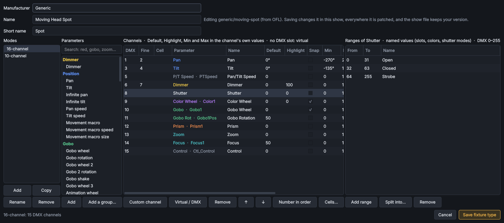

**Patch → Fixture editor…** builds a new fixture type, or edits the selected fixture's type (also on right-click of a fixture's type → **Edit this fixture type…**). Saving changes the type in this show, everywhere it's patched.

### Layout

- **Manufacturer**, **Name**, **Short name** at the top. The short name names newly patched fixtures.
- **Modes** on the left: **Add**, **Copy** (a mode as a starting point), **Rename** and **Remove**.
- **Parameters** library: every standard attribute with a sensible default, highlight value and starting ranges.
- **Channels** of the selected mode, in the middle.
- **Ranges** of the selected channel, on the right.

### Channels

| Column | Meaning |
| --- | --- |
| **Fine** | The slot of the 16-bit fine channel, if any. |
| **Cell** | For pixel and multi-head fixtures: which subfixture the channel belongs to. Empty is the whole fixture; `3` is subfixture 3; `3.2` is the second part of head 3. |
| **Parameter** | The attribute it controls (double-click for a list). |
| **Name** | The name shown for it. |
| **Default** | Where the channel rests, in its own values: 0 for a dimmer at zero, 0° for pan in the middle. |
| **Highlight** | Where **Highlight** puts it. Leave it empty (right-click → delete, or clear the cell) and Highlight leaves the channel alone. |
| **Snap** | Ticked, the channel doesn't fade: in a cue's fade (after its delay) or a programmer fade it jumps straight to the new value, so a gobo or color wheel doesn't spin through the slots in between. On by default for gobo and color wheels and macros. |
| **Min**, **Max** | The **value range**: the channel's value at each end of its DMX range. A dimmer is 0 to 100 (%); a 540° pan is -270 to 270, 0 the middle; a zoom might be 5 to 50 (°). Put the bigger number in **Min** for a channel that runs the other way. |
| **DMX from**, **DMX to** | The **DMX range** the value range covers: 0 to 255, or 0 to 65535 for a 16-bit channel (one with a **Fine** slot). Narrow it when only part of the channel does the job, such as a dimmer that's full at 200. |
| **Ranges** | How many named ranges it has. |

Default and Highlight are always in the channel's own values (degrees, %, or whatever its value range says), never raw DMX. The encoders show the same values.

### Adding channels

- **Double-click a parameter** (or select several and press **Add**) to put it on the lowest free DMX slot. A gap left by a removed channel is filled first. Pan and tilt come 16-bit.
- **Add a group…** adds a set in one go: RGB, RGBW, RGBA, RGBAW, RGBWA+UV, warm/cool white, CMY, pan/tilt, or the basics of a moving spot or wash.
- **Custom channel** adds a channel of your own after the selected one.
- **Virtual / DMX** makes the selected channel virtual or gives a virtual one the next free slot.
- **↑ ↓** reorder the list; **Number in order** renumbers the DMX slots in list order.

The parameter library has the attributes fixtures commonly use: besides dimmer, pan/tilt, RGBW and CMY, there are **infinite pan** and **infinite tilt**, pan and tilt speed, movement macros (with speed and size), more emitters (**Orange**, **Mint**, **Purple**, additive **Cyan**, **Magenta** and **Yellow**, Lime, Indigo, warm and cool white, UV), hue/saturation/brightness for virtual color, red shift, color macro speed, wheel shake, a third gobo wheel and animation rotation, **Prism 2** and its rotation, **Frost 2**, virtual strobe and strobe duration, effect speed, **framing blades** (in and swivel for 1–4, and blade rotation), auto focus, and control channels for haze, bubbles, dimmer speed mode, operating mode, program speed, motors and laser patterns.

### Editing several channels at once

Select several channels (Shift- or Ctrl-click), then right-click a cell in one of them: the editor sets that column for all of them. Give red, green, blue and dimmer the same **Cell** in one go, rename them, or set the same default, highlight, value range or DMX range. DMX slots and parameters are still set one by one.

### Ranges

Ranges name parts of a channel's DMX range: color wheel slots, gobos, shutter modes. They're in DMX values: 0–255, or 0–65535 for a 16-bit channel. **Add range** adds one after the last; **Split into…** replaces them with equal steps (for a wheel with 8 slots, say). Named ranges show on the encoders and in the fixture sheet.

### Cells (pixel fixtures)

To build a pixel bar: add one pixel's channels (for example an RGB group), select those rows, press **Cells…** and enter how many cells. The selected channels become cell 1 and are copied for the others after the last DMX slot. Channels without a cell number belong to the whole fixture (a master dimmer or strobe); see [Subfixtures](#subfixtures).

### Saving

**Save fixture type** (or **Create fixture type**) checks the type and saves it into the show. Problems, such as two channels on the same slot, show in red at the bottom and must be fixed first.

## Subfixtures: pixels and multi-head fixtures {#subfixtures}

Some fixtures are several lights in one: an LED bar with 8 separately controllable pixels, a panel of 25 cells, a fixture with four moving heads. Lumora patches these as **one fixture with subfixtures**.

### Numbering

The fixture keeps its ID, say **101**, and holds the channels that act on the whole fixture: a master dimmer, strobe, control. Each subfixture is numbered from it: **101.1**, **101.2** and up.

Subfixtures go **two levels deep**. On a fixture with four heads, each with an RGB ring and a main beam:

- **101** is the whole fixture (master dimmer, shutter).
- **101.1** to **101.4** are the heads (each with its own pan and tilt).
- **101.1.1** and **101.1.2** are head 1's ring and main beam.

### Selecting subfixtures

| Command | Selects |
| --- | --- |
| `Fixture 101.3` or `Fixture 101 Cell 3` | Cell 3 of fixture 101. |
| `Fixture 101.1 Thru 101.8` or `Fixture 101.1 Thru 8` | Cells 1 to 8. |
| `Fixture 101 Cell 1 Thru 4` | Cells 1 to 4. |
| `Fixture 101 Thru 104 Cell 2` | Cell 2 of fixtures 101, 102, 103 and 104. |
| `Fixture 101.1.1 Thru 101.4.1` | The ring of every head. |
| `Fixture 101 Cell 2.1` | Head 2's ring. |
| `Fixture 101` | The fixture itself, or every subfixture when it has no channels of its own. |

Subfixtures are fixtures in every other way: store them in groups, give them presets, put them in cues, and run effects across them pixel by pixel.

### In the fixture sheet

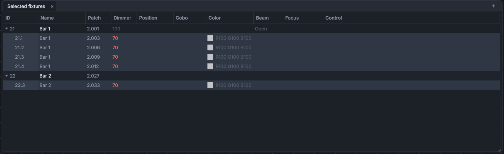

Subfixtures nest under their fixture. Tap the arrow in front of an ID (or double-click the ID) to open or close a fixture. A fixture that is only pixels has no channels of its own, so its row is just a label over the cells; selecting that row selects every cell. A closed fixture with some of its cells selected is tinted amber, so you can see they're in there.

### Defaults

A master dimmer (on the whole fixture) rests at full, so the cells light up as soon as you program them. Each subfixture's own dimmer rests at 0.

### Where subfixtures come from

- **GDTF**: heads are the sibling geometries that carry the same channels, whether written out one by one or repeated with geometry references; the beams inside a head become its parts.
- **Open Fixture Library**: matrix fixtures (one cell per pixel).
- **QLC+**: heads.
- **The fixture editor**: the **Cell** column and **Cells…**.

## Outputs and the DMX monitor {#outputs}

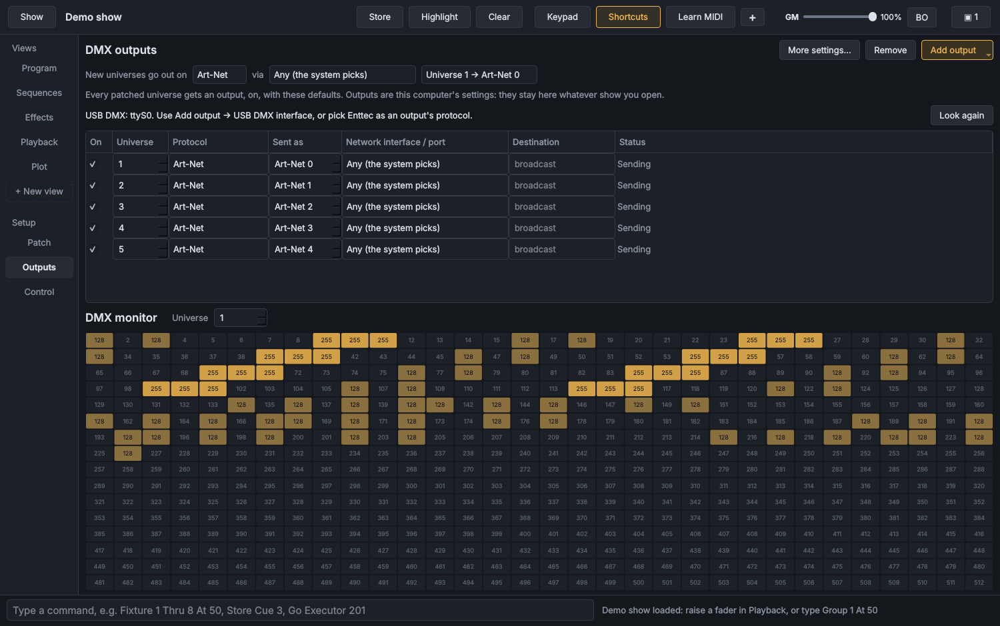

**Outputs** in the rail sets where DMX goes. Outputs are settings of *this computer*, not of the show: they stay the same whatever show you open.

### The output list

Each row is one output:

| Column | Meaning |
| --- | --- |
| **On** | Untick to stop sending this output. |
| **Protocol** | Art-Net, sACN, Enttec DMX USB Pro or Enttec Open DMX. |
| **Sent as** | The universe number on the network. Console universe 1 can go out as Art-Net 8. |
| **Network interface / port** | The network card (or USB port) to send from. *Any* lets the system pick. |
| **Destination** | An IP address to send to. Empty broadcasts Art-Net and multicasts sACN. |
| **Status** | Whether it's sending. |

### New universes get an output

When a universe is patched for the first time, Lumora adds an output for it with the defaults at the top of the screen: the protocol, the network card, and whether console universe 1 is Art-Net 0 or Art-Net 1 (sACN universes match the console's). Every output is on unless you untick it.

> **Tip:** Art-Net numbers universes from 0, and different nodes count differently. If your node shows nothing, try the other setting of *Universe 1 → Art-Net 0 / Art-Net 1*.

### Sending one universe to several places

Select an output and press **Add output** to send the same universe somewhere else too, for example Art-Net and sACN at once.

### USB DMX interfaces

Plug in the interface, press **Look again**, then **Add output → USB DMX interface** (or switch an output's protocol to Enttec and pick its port). The line above the list shows which interfaces are plugged in.

### More settings

**More settings…** has the sACN priority.

### The DMX monitor

The bottom half shows the 512 channels of a universe: what Lumora is sending right now. Channels above zero are lit. It follows the output you select, or pick a universe in its box. A **DMX monitor** window can also be added to any view (**+ → DMX monitor**).

## Control: MIDI and OSC {#control}

**Setup → Control** holds the two ways other things drive Lumora: **MIDI** (controllers, keyboards) and **OSC** (tablet apps, show control, media servers, another computer). Each has its own tab.

## MIDI {#midi}

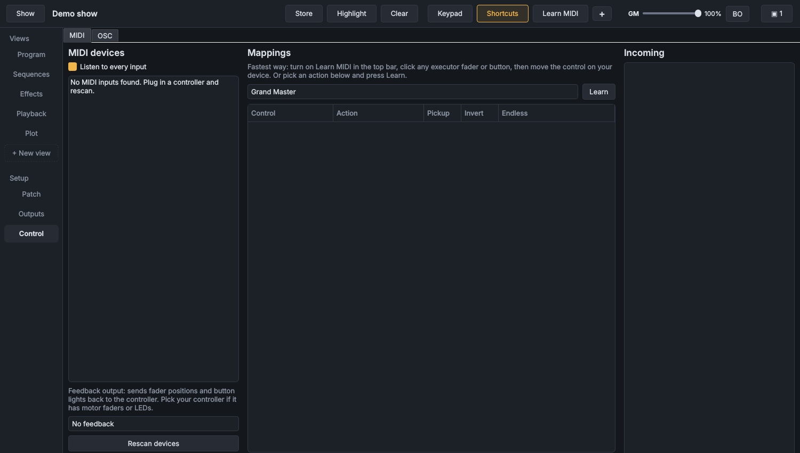

Any MIDI controller (a fader box, a keyboard, a pad controller) can drive Lumora's executors, the grand master and more.

### MIDI learn

1. Plug in your controller. Lumora listens to every MIDI input by default.
2. Turn on **Learn MIDI** in the top bar. Controls you can map get a dashed magenta outline. Learn MIDI works on the executor windows already on screen (open a Playback view, or add an Executors window), and nothing pops up over the encoders.
3. Tap a fader, button or knob on any executor. It turns solid magenta while it listens.
4. Move a fader, turn a knob or press a key on your controller. It's mapped.
5. Repeat for other controls, then turn Learn MIDI off.

You can also right-click an executor and choose **MIDI learn: fader** (or a button), or on the MIDI tab pick an action (such as **Grand Master**) and press **Learn**.

The **masters** map the same way: their faders and keys, in the Masters window. The **encoder bar** maps too: with Learn MIDI on, its knobs get the same outline and their number (E1, E2…). Tap one and turn a knob or endless encoder on your controller. See [Encoders and MIDI](#encoders-midi).

Notes, control changes (CC), pitch bend (14-bit faders) and program changes all work. A control can only do one thing; learning it again moves it.

### Pages

Mappings follow the current executor page, so the same physical faders drive executors 201–210 on whichever page is showing.

### Pickup and feedback

**Pickup** (on by default for faders) means a physical fader only takes over once it passes the on-screen fader's level, so nothing jumps when you change pages. If your controller has motor faders or LEDs, choose it as the **Feedback output**: Lumora sends fader positions and button lights back, and fader mappings skip pickup.

### The MIDI tab

- **MIDI devices**: the inputs found, **Listen to every input**, the feedback output and **Rescan devices**.
- **Mappings**: every mapping with its control, action, pickup, invert and endless. **Remove mapping** deletes one. **Invert** flips a fader's (or encoder's) direction. **Endless** marks an encoder mapping as an endless encoder rather than a knob.
- **Incoming**: the last MIDI messages received, to check your controller is seen.

Mappings are saved with the show.

## OSC {#osc}

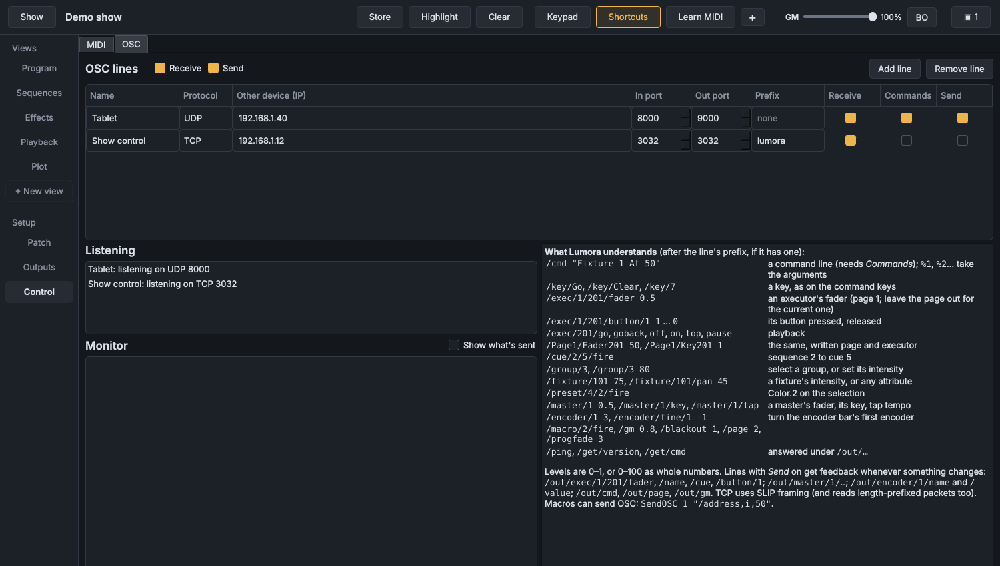

**OSC** (Open Sound Control) messages come over the network, from a tablet app, show control software, a media server or another console. Lumora takes them in on **lines**, and sends **feedback** back out so a tablet's faders and labels follow the show.

### Lines

Each line is one conversation. **Add line** makes one; set:

| Setting | What it does |
| --- | --- |
| **Name** | Yours, to tell lines apart (the monitor shows it). |
| **Protocol** | **UDP** (most apps) or **TCP**. Over TCP Lumora listens on the in port and talks back to whoever connects; packets are SLIP framed, and length-prefixed packets are read too. |
| **Other device (IP)** | Where UDP feedback goes. A broadcast address (192.168.1.255) reaches every device on the network. |
| **In port**, **Out port** | Lumora listens on the in port and sends to the out port. Lines can share an in port. |
| **Prefix** | Optional. With `lumora` set, messages must start `/lumora/` (so `/lumora/exec/201/go`) and feedback is sent that way, which keeps Lumora apart from other things on the same port. |
| **Receive** | Playback and data: executors, keys, cues, groups, fixtures, presets, masters, the grand master. |
| **Commands** | Whole command lines (`/cmd`). Off by default: anything on the network could then do anything you can type. |
| **Send** | Feedback on this line. |

**Receive** and **Send** at the top switch all input or all output at once. **Listening** shows the ports open (and any that couldn't be, because another program has them). The **Monitor** lists messages as they arrive; tick **Show what's sent** to see the feedback too. OSC lines are this computer's settings, like DMX outputs: they stay whatever show you open.

### What Lumora understands

Addresses come after the line's prefix. Levels are 0 to 1 as decimals, or 0 to 100 as whole numbers (`/gm 0.8` and `/gm 80` are the same). A button message with 1 presses, with 0 releases; with no argument it's a tap.

| Address | Does |
| --- | --- |
| `/cmd "Fixture 1 At 50"` | Runs a command line (needs **Commands**). `%1`, `%2`… in the text take the message's arguments: `/cmd "Executor 201 At %1" 75`. `/newcmd` clears the line first. |
| `/key/Go`, `/key/Clear`, `/key/7` | Presses a command key. |
| `/exec/1/201/fader 0.5` | An executor's fader, page 1. Leave the page out for the current page: `/exec/201/fader 0.5`. |
| `/exec/1/201/button/1 1` | Its first button, pressed (then `0`, released). |
| `/exec/201/go`, `/goback`, `/off`, `/on`, `/top`, `/pause` | Playback on an executor. |
| `/Page1/Fader201 50`, `/Page1/Key201 1` | Page and executor written in one, for apps with fixed layouts. `/Fader201` uses the current page. |
| `/cue/2/5/fire` | Sequence 2 (on whichever executor has it) to cue 5. `/cue/fire 5` sends the selected sequence to cue 5. |
| `/group/3` | Selects group 3; `/group/3 80` sets its intensity. |
| `/fixture/101 75` | A fixture's intensity (0–100); `/fixture/101/pan 45` any attribute by name (pan and tilt in degrees, the rest 0–100). |
| `/select "1 Thru 8"` | Selects fixtures, as typed after `Fixture`. |
| `/preset/4/2/fire` | Applies Color.2 (pools by number: 1 Dimmer, 2 Position, 3 Gobo, 4 Color, 5 Beam, 6 Focus, 7 Control, 8 All). |
| `/macro/2/fire` | Runs macro 2. |
| `/master/1 0.5` | A master's fader; `/master/1/key` its key, `/master/1/tap` tap tempo, `/master/1/reset`. |
| `/encoder/1 3` | Turns the encoder bar's first encoder (steps; negative turns down). `/encoder/fine/1` turns it finely. |
| `/gm 0.8`, `/blackout 1` | Grand master and blackout. |
| `/page 2`, `/page/next`, `/page/prev` | Executor page. |
| `/progfade 3`, `/progfade 0` | [Programmer fade](#prog-fade) time, or off. |
| `/undo`, `/redo` | Like Ctrl+Z and Ctrl+Y. |
| `/ping` | Answered with `/out/ping`. `/get/version`, `/get/page` and `/get/cmd` answer under `/out/get/…`. |

### Feedback

Lines with **Send** on get messages whenever something changes, under `/out` (after the prefix):

| Address | Holds |
| --- | --- |
| `/out/exec/1/201/fader`, `/name`, `/cue`, `/button/1` | An executor's level, its sequence's name, the live cue, and its button lights. |
| `/out/master/1/name`, `/value`, `/fader` | Each master. |
| `/out/encoder/1/name`, `/value` | What each encoder of the encoder bar does now, and its value. |
| `/out/cmd`, `/out/page`, `/out/gm`, `/out/blackout`, `/out/progfade` | The command line, the executor page, the grand master, blackout, programmer fade. |

A device that connects over TCP, or sends `/ping`, gets everything at once, so it starts up to date.

### Companion

A module for Bitfocus Companion (for Stream Decks and other button panels) talks to Lumora over these OSC lines: executor keys with the sequence's name and live cue on the button, lit like the console, playback and faders, the command keys, masters, the grand master, pages, programmer fade and the encoders on knobs. Add a line in Lumora with **Receive** and **Send** on (and **Commands** for command lines) and give the module the same ports. It's at github.com/typoirl/companion-module-lumora-console.

### Sending OSC from macros

`SendOSC 1 "/address,i,50"` sends a message on line 1: the address, then after commas each argument's type and value (`i` whole number, `f` decimal, `s` text, `T` and `F` true and false), or just the address and plain values: `SendOSC 2 "/scene/3 go"`. Put it in a macro or a cue command to fire projection, sound or another console from a cue.

# Programming

## Selecting fixtures {#selecting}

Almost everything starts with a **selection**: the fixtures you're about to change.

### Ways to select

- **The command line**: `Fixture 1 Thru 8`, `1 + 3 + 5`, `Fixture 1 Thru 10 - 5` (a bare number means Fixture).
- **Groups**: tap a group tile, or type `Group 2`.
- **The fixture sheet**: tap rows. Tap a selected row again to take it out.
- **Fixture tiles**: the tile layout of the fixture sheet; Shift-click adds a range. A fixture with subfixtures has a small arrow in its bottom-right corner: tap it to open the fixture, and its cells or heads follow it on a shared tray.

### Selections add up

Selections add up until you clear them. `1` then `3` then `Group 2` selects all of them. **Ctrl**-tap a group to take its fixtures back out. **Clear** (or **Esc**) empties the selection.

### Selection order

The order you select fixtures in matters: it's the order effects and spreads lay out across. `Fixture 4 Thru 1` selects them backwards.

### Next and Back: one fixture at a time

**Next ›** (on the command keys, **Page Down**, or `Next`) narrows the selection to its first fixture; pressing it again moves to the second, and so on. **‹ Back** (the key next to it, **Page Up**, or `Prev`) goes the other way. After the last fixture (or before the first) the whole selection comes back. While you step, values, presets and encoders only touch that one fixture, so you can trim a single light inside a group. `All` returns to the whole selection straight away. The command line shows where you are, such as *Fixture 3 (3 of 8)*.

### Select last

**Ctrl+L** (or `Last`) brings back the selection you had before the last **Clear**. Press it again to swap back to the one you replaced, which is handy for going between two sets of fixtures.

### Highlight

**Highlight** (top bar, or **H**) makes the selected fixtures bright and open so you can find them on stage, using each channel's highlight value (see [The fixture editor](#fixture-editor)). Turn it off when you're done; it doesn't change your values. Highlight follows **Next** and **Back**, so you can step through a group and see each light on its own.

## The programmer {#programmer}

The **programmer** holds the values you're working on. Whatever is in it goes to the stage, on top of everything else that's playing.

### Putting values in the programmer

- **At**: `At 50` sets intensity to 50%. `At Full` and `At Zero`; `At At` (pressing At twice) is full.
- **Encoders**: drag, scroll or type a value (see [Encoders](#encoders)).
- **Presets**: tap a preset tile, or type `Color.3` or `At Color.3`.
- **Any attribute by name**: `Zoom 30` or `Attribute Zoom At 30`. Pan and tilt take degrees: `Pan -90`.
- **Up or down from where it is**: `+` before a number adds it, `+-` takes it away: `Pan +10`, `Tilt +-10`, `Fixture 1 Thru 4 Red +20`, `At +10` (intensity). Each fixture moves from its own value (the programmer's, else what's on stage): pan at 25 with `Pan +-10` goes to 15. Pan and tilt go in degrees, the rest in their own values (% for a dimmer or a color).
- **The color picker**: see [Color](#color).

Values in the programmer show in **coral** in the fixture sheet and on the encoders.

### Clearing

**Clear** works in steps:

1. If fixtures are selected, Clear deselects them (their values stay in the programmer).
2. Pressed again with nothing selected, Clear empties the programmer.

**Clear All** (`ClearAll`, **Shift+Esc**) does both at once.

### Programmer fade {#prog-fade}

Normally programmer values snap. With **Programmer fade** on, they fade: setting a level, applying a preset, and clearing all take that many seconds, from where the lights are to where they're going. Handy for busking, or for checking a look the way it will play.

- **Show → Config…** switches it on and off and sets the time.
- On the command line or in a macro: `ProgFade 3` (on, 3 seconds), `ProgFade On`, `ProgFade Off`, and `ProgFade` on its own toggles it.

Values already in the programmer when you switch it on stay where they are. It doesn't change the cue times you store.

### Taking values out

- `Remove` drops the selected fixtures' values from the programmer.
- `Remove Fixture 3 Thru 5 Cue 2` drops fixtures from a stored cue.

### Defaults {#defaults}

Every fixture has a default for each attribute: where it rests when nothing plays.

- **Default Default** puts the selection's default values into the programmer: press the **Default** key twice, press **D** twice, or type `Default`. With nothing selected, or `Default All`, it does every fixture.
- The encoder bar's **Default** button does the current feature for the selection; press it again within a second and a half for every attribute.
- `Store Default` stores the programmer's values as the new defaults for those fixtures (presets stay references). `Store Default /overwrite` starts the defaults over; `Delete Default` removes stored defaults for the selection, or all of them.

`Home` works as another name for `Default`.

### Update

`Update` merges the programmer into the cue that's live on the selected sequence. `Update Cue 3` and `Update Color.1` merge into a specific cue or preset.

## Park {#park}

**Parking** freezes attributes where they are on stage. A parked attribute holds its output whatever sequences play, whatever is in the programmer, and through Highlight, until you unpark it. Use it for a work light that must stay on, a mover that has to stay put during a focus, or a fixture that's misbehaving.

### Parking

| You type | Parks |
| --- | --- |
| `Park` | Everything on the selected fixtures. |
| `Fixture 101 Park` or `Park Fixture 101` | Everything on fixture 101 and its subfixtures. |
| `Fixture 101 Intensity Park` | Only its intensity. Features work the same way: `Position`, `Gobo`, `Color`, `Beam`, `Focus`, `Control`. |
| `Fixture 101 Attribute Pan Park` | Only its pan. |
| `Attribute Pan Park` | Pan on the selected fixtures. Tap **Pan** on the encoder bar to type the `Attribute Pan` part. |
| `Park Group 2 Position` | Position on every fixture in group 2. |

An attribute parks at the value it has on stage at that moment. Parked attributes are saved with the show.

### Unparking

`Unpark` works the same way (`Fixture 101 Unpark`, `Unpark Fixture 101 Attribute Pan`, `Unpark Group 2`). `Unpark All` releases everything.

### The Park window

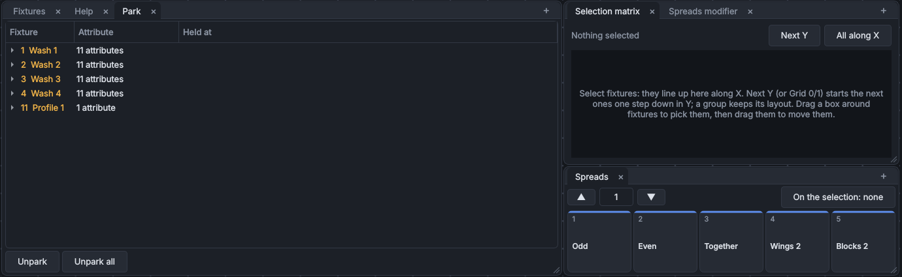

**+ → Park** lists every parked fixture; open one to see its attributes and the values they're held at. Select rows and press **Unpark** (or double-click a row), or **Unpark all**.

## Encoders {#encoders}

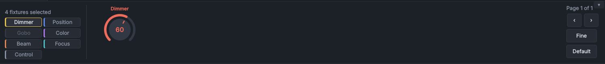

The encoder bar shows a knob for each attribute the selected fixtures have, one feature at a time.

### Using the encoders

- **Pick a feature** on the left: Dimmer, Position, Gobo, Color, Beam, Focus or Control. Features the selection doesn't have are grayed out.
- **The selection** shows just above the features: how many fixtures, and the spreads on them. It keeps the features' width however long it gets (hover for all of it), so nothing on the bar moves. With the bar tucked away, it shows beside **Encoders**.
- **Drag** a knob up or down, or **scroll** over it.
- **Double-click** a knob to type a value.
- **Right-click** a knob for its value, its named ranges (gobos with their pictures, color wheel slots, shutter modes), **Default**, **Full** and **Zero**.
- **Fine**, or holding **Shift** on the keyboard, makes small steps: dragging, scrolling and turning a MIDI encoder all go a tenth as far.
- **‹ ›** page through more knobs. A page has up to five (change it in [Config](#interface)), fewer when they don't fit.
- **Default** puts this feature's defaults in the programmer (twice: every attribute).
- **Tap a knob's name** to put `Attribute Pan` (or whichever it is) on the command line, ready for `Park`, `At 30` or `Unpark`.

Values show, and are typed, in the channel's own units: percent for most, degrees for pan and tilt, or the value range the fixture type gives a channel. On a zoom of 5 to 50, `Attribute Zoom At 30` (or typing 30 after a double-click) sets it to 30.

The ring around each knob shows where the value sits in its range. Coral means the value is in the programmer. The knobs follow the output live (up to 30 times a second, whenever it changes), so a cue fading in moves them too.

The arrow in the bar's top-right corner hides it, leaving a thin strip with the arrow to bring it back.

### Encoder windows

**+ → Encoders** adds the encoders as a window, anywhere in a view and on any screen. Each one has its own feature and page, so one window can stay on Position while the bar shows Color. Right-click its tab to give it its own number of encoders per page. Windows don't answer MIDI; the bar does.

### Encoders and MIDI {#encoders-midi}

A MIDI knob or endless encoder maps to an encoder by its **place on the bar**, not by its attribute: map your first knob to the first encoder and it turns Pan on the Position page, Dimmer on the Dimmer page, and whatever comes first on the next page. Changing feature or page takes your controller with it.

- **Learn it**: turn on **Learn MIDI**, tap an encoder on the bar (it shows E1, E2…) and turn the control. Or right-click the encoder → **MIDI learn: encoder**, or pick **Encoder 1** on the MIDI tab.
- **Endless encoders and knobs** both work. An endless encoder (sending 65/63, or 1/127, for each step) moves the value a step at a time; a knob moves it as far as you turn it, from wherever it is, so nothing jumps when the page changes. Lumora guesses which you have from the first message; tick or untick **Endless** on the MIDI tab if it guessed wrong.
- **Fine**: press Fine on the bar, or hold Shift on the keyboard while turning.
- **The push**: right-click an encoder → **MIDI learn: push**, then press a button (or an encoder's push) on your controller. Pressing it opens that encoder's ranges, the same as right-clicking it. The push is only learned this way, not by tapping with Learn MIDI on.
- **Forget MIDI mappings** in the same right-click menu removes both.

### Framing shutters {#shapers}

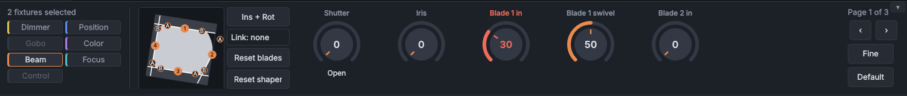

When the selection has framing shutters, the **Beam** category draws them over the beam: the light gray circle is the beam, the dark gray blades cover it, and a white line marks each blade's edge. Blade 1 is at the top, 2 on the right, 3 at the bottom, 4 on the left; the whole picture turns with the module's rotation (**Blade rotation**).

- **Drag a blade's number** in or out to set its insertion. Press anywhere and the nearest handle is picked up.
- **Drag its A or B end** to swivel the blade (**Ins + Rot**). On fixtures whose blades have two corners (A and B parameters), switch to **A + B** and the ends move each corner on its own, for triangles and slants.
- **Link** moves other blades with the one you drag: **all** of them, the opposite blade the same way (**parallel**, which slides the opening across), or the opposite blade the other way (**mirrored**, which closes in from both sides).
- **Reset blades** takes the blades out; **Reset shaper** also straightens the swivels and the module.

The knobs beside it are the same blades as numbers. The demo show has four profiles with framing shutters (group 2, Profiles).

## Position: pan, tilt, the XY pad and Flip {#degrees}

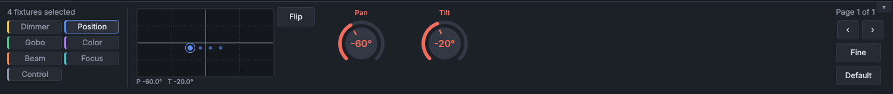

### Pan and tilt in degrees

Lumora programs pan and tilt in the fixture's physical degrees, with **0 in the middle** of its range. A 540° pan runs from -270 to 270; a 270° tilt from -135 to 135. Every fixture rests at 0°, 0°.

Presets, cues, defaults and effects all keep degrees. A Universal position preset therefore points fixtures with different ranges the same way.

The ranges come from the fixture file (GDTF physical ranges, Open Fixture Library angles, QLC+ pan and tilt maximums). When a file doesn't say, Lumora assumes 540° pan and 270° tilt; you can set the real range in the fixture editor's **Min** and **Max** columns.

On the command line, `Attribute Pan At -90` and `Attribute Tilt At 45` take degrees. `Full` and `Zero` mean the ends of the range.

### The XY pad

In the Position category, the **XY pad** shows every selected fixture as a dot: pan across, tilt up and down, each across its own range. The first selected fixture is ringed; its pan and tilt are written underneath. Drag on the pad to move all the selected fixtures together. Hold **Shift** (or turn on **Fine**) for small moves.

### Flip

A moving head can point at the same spot two ways: pan one way with tilt forward, or pan half a turn round with tilt mirrored. **Flip** (next to the pad, or type `Flip`) switches the selection to the other way. Pan goes half a turn round, choosing whichever way stays nearer the middle of its range, and tilt mirrors. A fixture without room to go round is left alone. Flip is useful when a fixture would otherwise swing a long way between cues.

## Color {#color}

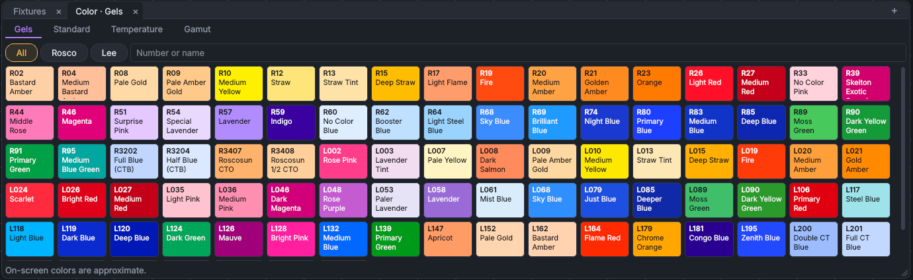

There are three ways to set color:

1. **Color presets**: tap one (the demo show has the thirteen standard colors and a 3200K warm white).
2. **The Color encoders**: one knob per emitter or wheel.
3. **The color picker** window (**+ → Color picker**).

### The color picker

Four tabs:

- **Gels**: Rosco and Lee gels by number or name. Type to filter.
- **Standard**: named colors plus a hue/saturation field.
- **Temperature**: 1800–10000 K. Fixtures with warm and cool white blend them.
- **Gamut**: tap on a CIE 1931 diagram. The outline is what the selected fixtures can actually make: their emitters' colors (red, green, blue, the whites, amber, lime…) and everything in between. An RGB fixture shows a triangle, one with more emitters a bigger shape, a fixture with only warm and cool white a short line between the two, and a color-wheel fixture its wheel's colors. A tap outside it gives the nearest color they can make. With nothing selected it shows a typical RGB LED.

Whatever you pick goes to the selected fixtures using what they have: RGB (with white, amber, lime or UV) mixing, CMY, or the nearest named slot of a color wheel.

### Color presets from the picker

Pick a gel, a standard color or a color temperature, then store a Color preset (**Store**, then tap an empty Color tile, or `Store Color.5`). The preset is named after what you picked:

| You picked | The preset is called |
| --- | --- |
| A gel | Its number and name: "L201 Full CT Blue" |
| A standard color | Its name: "Red" |
| A temperature button | Its name and temperature: "Tungsten 3200 K" |
| A point on the temperature bar | The temperature: "4150 K" |

Rename it like any preset (right-click → **Name**). A name you give when storing (`Store Color.5 "Front blue"`) always wins, and so does the name of a preset you merge into. Once you change the colors in the programmer by other means (encoders, another preset, the hue field or the gamut), the next preset gets an ordinary name again.

## Selection matrix {#selection-matrix}

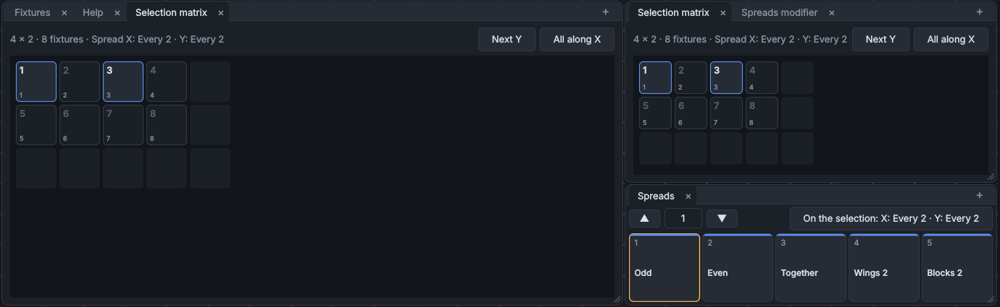

The selection isn't only a list: every selected fixture has a place on a grid, **X** across and **Y** down. Effects and spreads can run along X, along Y, or both, so a 4 × 2 block of lights can chase left to right, top to bottom, or corner to corner.

### Building it

- Selecting adds fixtures along **X**, in order: `Fixture 1 Thru 4` fills X 0 to 3.
- **Next Y** (`NextY`, or the key on the command keys) starts the next Y: `Fixture 1 Thru 4 NextY Fixture 5 Thru 8` makes two rows of four.
- Positions can be given outright: `Fixture 5 Grid 3/1` puts fixture 5 at X 3, Y 1. `Grid 2/1` moves where the next selected fixture goes. `Grid 0/0 Thru 3/1` lays the selection out over that area, filling X first.
- In the **Selection matrix** window (**+ → Selection matrix**), each fixture is a square. **Drag a box** over empty space to pick several (Ctrl or Shift adds to the pick), or tap one; Ctrl-click picks or unpicks one. Then **drag** the picked fixtures: they move together, keeping their shape, and fixtures in the way take the cells they left. Right-click for **Pick all**, **Next Y**, **All along X, in selection order** (back to one line), or to take fixtures out of the selection.

Clearing the selection clears the matrix. Coordinates start at 0.

### In the demo show

Group 3, **Pixel bars**, is the eight pixel bars as 8 × 8: each bar's cells along X, one bar per Y (`Fixture 21.1 Thru 21.8 NextY Fixture 22.1 Thru 22.8 NextY …`). The Pixel bars cue list on executor 203 runs effects on it: a white chase across (X), a blue chase down (Y, which starts by itself 8 seconds later), a rainbow corner to corner (X and Y), and alternate bars red, with a Y spread that takes every other bar. That last cue runs macro 4, which sends the profiles to the audience. Group 4, **Blinders**, is the blinders as 4 × 2: the four along X, their top cells at Y 0 and bottom cells at Y 1.

### Groups keep it

A group stored from a selection keeps the X/Y layout: selecting the group later puts the fixtures back where they were. Groups stored before keep a single line along X.

## Groups {#groups}

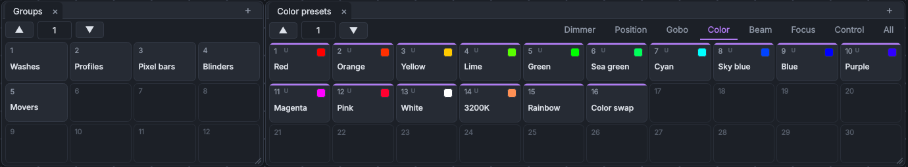

A **group** is a stored selection, in order.

- **Store a group**: select fixtures, press **Store**, tap an empty group slot. Or type `Store Group 3 "Front"`. Storing onto a group that exists asks: Overwrite, Merge or Remove (see [Storing onto something that exists](#store-existing)).
- **Use it**: tap the tile (adds its fixtures to the selection), or type `Group 3`. **Ctrl**-tap takes its fixtures out.
- **Edit it**: right-click the tile: **Name**, **Update with selection** (replaces its fixtures with the current selection), **Delete**.
- A group tile is outlined when the selection is exactly that group.

A group remembers where its fixtures sat in the [selection matrix](#selection-matrix), so a group of a 4 × 2 block comes back as 4 × 2.

Groups are referenced by blueprint lines, so reordering a group (storing it again in a different order) changes the cues that use it.

## Presets {#presets}

A **preset** is a named set of values for one feature: a color, a position, a gobo, a zoom. Cues store references to presets, so editing a preset changes every cue that uses it.

### Preset pools

There are eight pools: **Dimmer**, **Position**, **Gobo**, **Color**, **Beam**, **Focus**, **Control** and **All** (which stores every attribute). The presets window shows one pool at a time; switch with the tabs along its top. On the command line presets are written by pool name and number: `Dimmer.1`, `Position.2`, `Gobo.3`, `Color.4`, `Beam.5`, `Focus.6`, `Control.7`, `All.8` (or `Preset 4.1`).

### Storing a preset {#storing-presets}

1. Select fixtures and set the values (for example a color).
2. Press **Store** and tap an empty slot in the right pool, or type `Store Color.5 "Deep blue"`.

Only the programmer values that belong to the pool's feature are stored. Storing onto a preset that exists asks what to do: **Overwrite**, **Merge global**, **Merge selective** or **Remove** (see [Storing onto something that exists](#store-existing)).

### The Preset builder {#preset-builder}

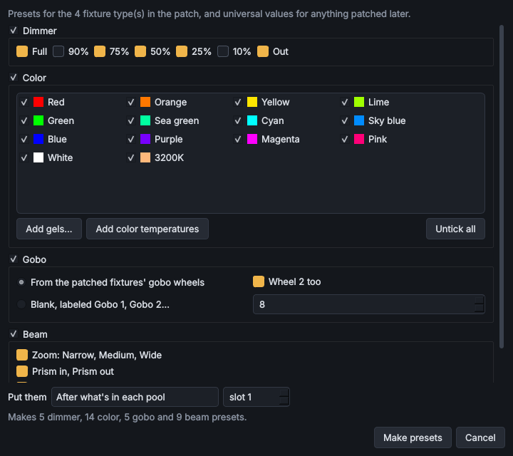

**Show → Preset builder…** fills the pools for you, from what's patched:

- **Dimmer**: Full, 90 %, 75 %, 50 %, 25 %, 10 % and Out; tick the ones you want.
- **Color**: the standard colors (the same as the demo show's: red, orange, yellow, lime, green, sea green, cyan, sky blue, blue, purple, magenta, pink, white and 3200K). **Add gels…** and **Add color temperatures** put more on the list from the color picker's gel books and temperatures. Universal presets, so they work on anything with color, plus each patched type's own values (its emitters, CMY or color wheel).
- **Gobo**: one preset per gobo on the patched fixtures' wheels (and the second wheel, if you tick it), named after the gobos. Or **Blank**, labeled Gobo 1, Gobo 2… to fill in later.
- **Beam**: zoom narrow, medium and wide, and prism, frost and iris for fixtures that have them.

Dimmer, color and zoom presets can be made with nothing patched: they're universal, and work on whatever you patch later. Gobo, prism, frost and iris come from the fixtures, so they need some patched (blank gobo presets don't). **Put them** decides where they go in each pool: **After what's in each pool** (the default), **From slot**, skipping slots already used, or **From slot, replacing what's there**, from the slot number you give.

### Layers: Universal, Global, Selective

A preset can hold three layers. For each fixture, the most specific layer that has a value wins:

| Layer | Holds | Wins over |
| --- | --- | --- |
| **Universal** (U) | One value per attribute, for any fixture that has it. | — |
| **Global** (G) | One value per fixture type. | Universal |
| **Selective** (S) | One value per fixture. | Global and Universal |

Dimmer and Color presets store **Universal** by default, so "Red" works on every fixture with red. Position, Gobo, Beam, Focus, Control and All store **Selective**, because a position belongs to particular fixtures. Add `/universal`, `/global` or `/selective` to store another layer (`Store Color.3 /selective` gives a few fixtures their own version of a universal color), or right-click a preset and choose which layer to update. Each tile shows the layers it has.

### Applying presets

Tap a preset tile with fixtures selected, or type `Color.3`. The programmer stores a *reference* to the preset, and the fixture sheet shows the preset's name instead of numbers.

### Editing presets

Right-click a tile: **Name**, update it with the programmer (choosing the layer), or **Delete**. To change what a preset holds, apply it, adjust the values, and store or update it again.

### Effects in presets

Storing a preset also stores any running effect that drives that preset's feature (an **All** preset takes every running effect), **with its spread**: a strobe laid out with a random spread plays random wherever the preset goes. The preset's layer says where the effect plays, just like its values:

| Stored as | The effect plays on |
| --- | --- |
| **Universal** (`/universal`) | Whatever the preset is applied to. |
| **Global** (`/global`) | Fixtures of the same types as the ones it was stored from. |
| **Selective** (`/selective`) | Only the fixtures it was stored from. |

For example: select some pars, `Spread Direction Random`, run the Strobe effect, then `Store All.5 /universal`. Now `All.5` on any selection strobes it with random offsets. Or run a Circle on one spot and `Store Position.8 /global`: applying Position.8 circles every spot of that type, and leaves other fixtures alone.

Applying the preset runs its effects on the selection (as far as each layer reaches), with the effect's stored spread, or the active spread if it has none.

## Spreads {#spreads}

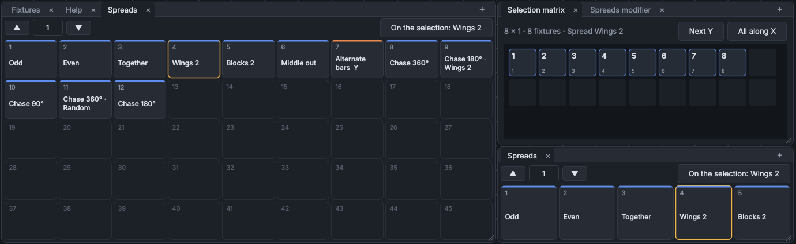

A **spread** changes how the selection is used. It can thin the selection (only every other fixture, say) and it decides how effects roll across the fixtures.

### What a spread holds

| Setting | Effect |
| --- | --- |
| **Every Nth fixture** and **Starting at** | Interleave: which of the selected fixtures take values and effects. Every 2 starting at 1 is fixtures 1, 3, 5…; starting at 2 is 2, 4, 6… |
| **Phase from / to** | How an effect's phase spreads across the fixtures, from -720 to 720 degrees. 0 to 0 moves everything together; 0 to 360 is a full chase; -360 to 0 runs it the other way; 0 to 720 goes round twice. |
| **Blocks** | Neighbors share a phase: Blocks 2 moves pairs together. |
| **Groups** | The phase repeats every N fixtures. |
| **Wings** | The layout is mirrored: Wings 2 runs from both ends to the middle (or out). |
| **Direction** | Forward, backward, ends to middle, middle to ends, or random. |

### X and Y {#spread-axes}

Every spread works along **X** of the [selection matrix](#selection-matrix), along **Y**, or both (set under **Works along** when you edit it). There are two active spreads, one for each, and they **stack**: an X spread of Every 2 and a Y spread of Every 2 leave every other fixture of every other row. Each one filters and lays out along its own direction. A spread that works along both fills both.

With all the fixtures along X (the usual selection), only X spreads change anything.

### The active spreads

The spreads on the selection are the **active spreads**. They go with the selection: clearing the selection resets them. The encoder bar shows them next to the selection count, and the Spreads window's header shows them ("X: Every 2 · Y: Every 2").

While a spread with an interleave is active, values you set (`At 50`, presets, encoders) go only to the fixtures it picks.

### The Spreads window

Add it with **+ → Spreads**.

- **Tap a tile** to put that spread on the selection, on the directions it works along; tap it again to take it off. An X spread and a Y spread can both be on.
- **The header** shows the active spreads; tap it to open the [Spreads modifier](#spread-modifier).
- **Store** then tap a slot keeps the active spreads in the pool. With an X and a Y spread on, both go in: one spread that works both ways if they're the same, or the X one in that slot and the Y one in the next free slot. `Store Spread 5 /x` (or `/y`) keeps just one.
- **Right-click** a tile to rename it, change its settings, put it on the selection, update it with the active spread, or delete it.

The demo show starts with Odd, Even, Together, Wings 2, Blocks 2, Middle out and Alternate bars (a Y spread), plus the spreads its effects use (see [How effects spread across fixtures](#effect-spreads)).

### The Spreads modifier {#spread-modifier}

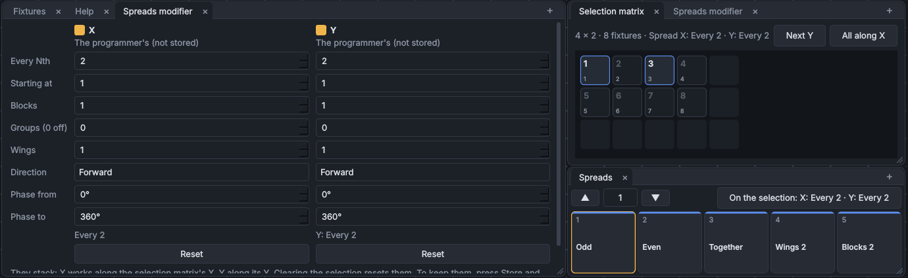

**+ → Spreads modifier** (or tap the Spreads window's header) shows the X and Y spreads side by side, to change while you look at the lights.

- Each side has a switch to turn that direction on or off, every setting, and what it's changing underneath its name.
- If you tapped a spread in the pool, that side edits **that pool spread**: the change is kept, and effects using it change too.
- Otherwise it's **the programmer's own**, until you store it: press **Store** and tap a slot in the Spreads pool (or `Store Spread 5`), or store a cue or preset that keeps it.
- **Reset** puts a side back to plain (every fixture, 0 to 360°, forward). There's no Off: clearing the selection resets both.

### On the command line

```
Spread 3                                  put spread 3 on the selection
Spread X Every 2                          change the X spread
Spread Y Every 2 Offset 2                 change the Y spread (they stack)
Spread X Off / Spread Y Off               reset one direction
Spread Off                                reset both
Store Spread 5                            keep them (X and Y; /x or /y for one)
Spread Every 2 Offset 2                   every other fixture, starting with the second
Spread Wings 2 Blocks 2                   change the active spread
Spread Phase -360 Thru 0                  phase range in degrees
Spread Direction Backward                 forward, backward, inward, outward, random
Store Spread 3 "Evens"                    keep it in the pool
Blueprint Cue 1 Group 2 Effect 1 Spread 3 use it on a blueprint line
```

## Effects {#effects}

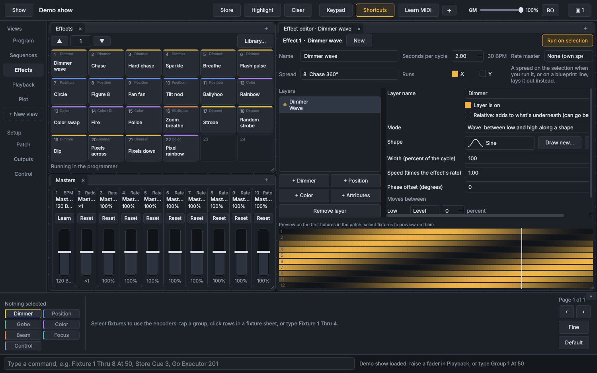

An **effect** makes values move by themselves: a dimmer chase, a color rainbow, a circle of movement.

### Layers

An effect is a stack of **layers**, each driving one part of a fixture:

- **Dimmer**: intensity.
- **Position**: pan and tilt.
- **Color**: every color system a fixture has: red, green and blue, white (or warm and cool white), amber, orange, yellow, lime, mint, cyan, indigo, purple and magenta emitters (each takes the part of the color it can make, the rest goes to RGB), hue and saturation on virtual-color fixtures, CMY flags, CTO and the color wheel. Switch off any family per layer to leave it alone; its share goes to the others.
- **Attributes**: any other attributes you pick (zoom, iris, gobo rotation…).

**Relative** (Dimmer and Attributes layers): the points are amounts added to whatever value is already there, from a running executor or the programmer, instead of the values themselves. They go from -100 to 100, so an effect can take a level down as well as up: -50 to 0 dips an 80 % executor between 30 % and 80 %, and never lifts a fixture that's out. With Relative on, a plot under the points draws the wave from low to high around zero, and the preview runs over the live output. The library's **Dip** is one.

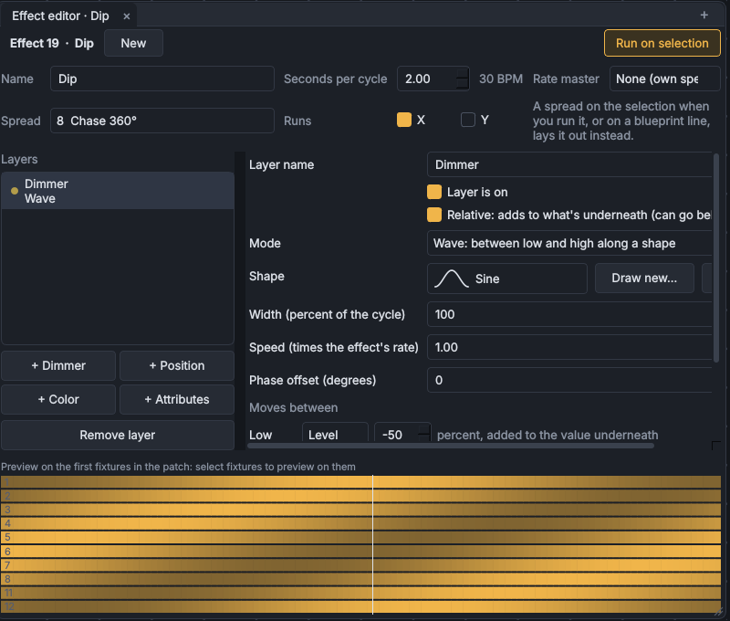

### Modes

| Mode | What it does |
| --- | --- |
| **Wave** | Between a low and a high point, following a *shape*: sine, ramps, triangle, square, pulse, breathe, random, smooth random, or one you draw. |
| **Steps** | Through any number of points, with a crossfade (0 snaps, 100 fades the whole step), in order, there and back, or at random. |
| **Form** | Position only: a circle, figure 8, pan or tilt line, square or triangle, around where each fixture points or around a position preset. Sizes are shares of each fixture's range. |

**Points** can be levels, colors, pan/tilt values in degrees, or references to presets, so an effect holds no fixture-specific data and runs on whatever you select.

**Shapes** are shared: draw one with **Draw new…**, and editing it later updates every effect that uses it.

Each layer has a **speed** multiplier and a **phase offset**, so a color can roll at half the speed of a dimmer chase.

### How effects spread across fixtures {#effect-spreads}

How an effect rolls across the fixtures (its phase, blocks, groups, wings and direction) comes from a [spread](#spreads) in the pool. Each effect has one, chosen under **Spread** in the effect editor; effects that share a spread change together when you edit it. Effects from the library, and ones from older shows, get the pool spread that matches their layout (made for them if there's none, named like "Chase 360°" or "Together"). **None** keeps the effect's own layout.

A spread on the selection when you run the effect, or on the blueprint line it's in, lays it out instead.

### Along X, Y or both {#effect-axes}

Each effect runs along the [selection matrix](#selection-matrix)'s **X**, its **Y**, or both: tick **Runs X** and **Y** in the effect editor. A new effect runs on X only. On Y, a 4 × 2 block chases top row then bottom row; with both, the X and Y phases add together, so the wave runs corner to corner. The X spread lays out the X direction and the Y spread the Y direction.

### The Effects pool

- **With fixtures selected, tap** an effect to run it on them. Running effects are listed under the pool with live **Rate** and **Size** sliders, the spread they run with, and **Stop**.
- **With nothing selected, tap** an effect to open it in the editor.
- **Right-click** a tile: name, **Edit effect…**, **Run on selection**, **Stop**, **Duplicate**, **Delete**. Right-click an empty slot to create a blank effect or one from the **library** (19 ready-made effects: dimmer waves and chases, circles, fans, a smooth rainbow, color swaps, a strobe, a random strobe, a relative dip, and more).

In the demo show the **Effects** view has the ten [rate masters](#rate-masters) under the pool, to set the effects' speed.

### The effect editor

Add it with **+ → Effect editor**. It shows the effect's **name** and **seconds per cycle** (with the BPM it makes), its **layers** (add with **+ Dimmer**, **+ Position**, **+ Color**, **+ Attributes**), the selected layer's settings, and a live **preview**: one row per selected fixture across one cycle, with a playhead that runs with the effect. **Run on selection** starts it.

### On the command line

```
Effect 12                  run effect 12 on the selection
Effect 12 Rate 150 Size 50 adjust it (percent, percent)
Effect 12 Off              stop it
Effect Off                 stop the effects on the selection
```

### Effects in cues

Storing a cue stores the running effects. Blueprint lines can carry effects on a group (`Blueprint Cue 4 Group 1 Effect 12`), and a preset in a blueprint line brings its stored effects too: `Blueprint Cue 4 Group 1 All.5` puts All.5's strobe, with its spread, on group 1 (a spread on the line replaces the preset's). An executor's fader scales an effect's intensity like any other value.

**Effects follow the cue's fade.** Going to the next cue, the old cue's effects fade out and the new cue's fade in over the cue's fade time (after its delay), and an Off fade fades them out too. A cue with no fade still changes at once. Effects run in the cue they're stored in; they don't track into later cues yet.

# Cues and playback

## Storing {#storing}

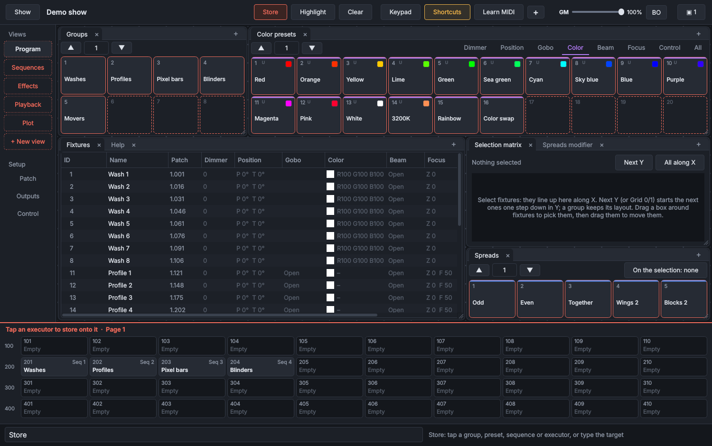

**Store** is how anything gets kept. Press **Store** (or **S**), then tap where it goes:

| Tap | Stores |
| --- | --- |
| A group slot | The selection as a group (onto one that exists, it asks). |
| A preset slot | The programmer's values for that pool's feature (onto one that exists, it asks). |
| A sequence slot (in a sequence pool) | The next cue of that sequence (with one cue, it asks). |
| An executor | The next cue of its sequence (a sequence with one cue asks what to do). An empty executor gets a new sequence. |
| A view in the rail | The windows on screen into that view. |
| A spread slot | The active spread. |

When the view has no executor window, Store shows a tile for every executor in the 100, 200, 300 and 400 rows where the encoders usually are. **Esc** cancels Store.

You can also type: `Store Cue 5`, `Store Group 3 "Front"`, `Store Color.1 "Red" /overwrite`, `Store Sequence 2 Cue 1.5`, `Store Cue 1 Thru 40` (a whole run of empty cues).

### Storing onto something that exists {#store-existing}

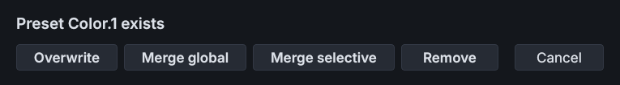

Storing onto a group, a preset or a cue that's already there asks what to do. The answers are always in the same order:

| Store onto | Overwrite | Merge | Add cue | Remove |
| --- | --- | --- | --- | --- |
| A group | The selection replaces the group. | **Merge**: the selection's new fixtures join it (in a new row of its layout when it has one). | — | The selection comes out of it. |
| A preset | The programmer replaces it. | **Merge global** (per fixture type) or **Merge selective** (per fixture): the programmer's values join it in that layer. | — | The programmer's attributes (and effects) come out of it. |
| A sequence with one cue, or a cue | The programmer replaces the cue. | **Merge**: the programmer's values join the cue. | **Add Cue 2**: a new cue after it (a sequence with one cue). | The programmer's attributes (and effects) come out of the cue. |

**Cancel** stores nothing. A sequence with more than one cue doesn't ask: Store adds its next cue. A group, preset or cue left empty by **Remove** is deleted.

On the command line, an option answers ahead: `Store Group 3 /merge`, `Store Color.1 /selective`, `Store Sequence 2 /new`, `Store Cue 4 /remove`, `/overwrite` (or `/o`). A macro line that stores onto something that exists without one of these asks too.

## Sequences and cues {#sequences}

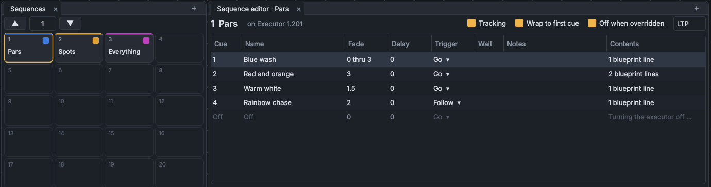

A **sequence** is a list of **cues**. The **Sequences** view has the **sequence pool** on the left and the **Sequence editor** on the right. Like the effects pool and the effect editor, tap a sequence in the pool and the editor shows its cues.

### The sequence pool

**+ → Sequences** adds a sequence pool window. Tap a sequence to select it: every Sequence editor shows it, and it becomes the sequence `Cue` commands work on. Right-click it for:

- **Name**.
- **Priority**: Low, LTP, HTP or Ultra (see [Priority](#priority)).
- **Off when overridden**: Yes or No.
- **Appearance…**: the sequence's color. Pick a standard color or any hue in the color field, or type it as hex (`#E04050`) or as red, green and blue (0–255); **No color** takes it away. **Follow fixtures** takes the color its fixtures show on stage while it plays (its first cue's colors while it's off), so an executor running a color chase changes color with it (`Appearance Sequence 2 Follow`). It shows as a chip on its pool tile, a stripe along the top of its executors and a tint in their faders.
- **Assign to executor…** and **Delete sequence**.

Tiles show the priority in the corner when it isn't LTP.

### The Sequence editor

**+ → Sequence editor** adds one. It edits the selected sequence (tap one in a sequence pool, or type `Sequence 2`), and its tab names it: "Sequence editor · Washes".

| Column | Meaning |
| --- | --- |
| **Cue** | The cue number. Cues can have decimals (1.5) to fit between others. Double-click to renumber. |
| **Name** | A name for the cue. |
| **Fade** | Seconds the cue takes to fade in. |
| **Delay** | Seconds to wait before the fade starts. |
| **Trigger** | How the cue starts: **Go**, **Wait** or **Follow** (see below). Tap or right-click it to choose. |
| **Wait** | Seconds, for a Wait trigger. Typing one makes the cue a Wait. |
| **Macro** | A macro that runs as the cue starts: type its number (empty or 0 for none), or right-click for a list. Select several cues to give them all the same one. `Cue 3 Macro 2`. |
| **Notes** | Notes for the operator ("Wait for the actor to sit"). |
| **Contents** | What the cue holds: blueprint lines, fixtures programmed, effects. |

Double-click or right-click a cell to edit it. Select several cues (Ctrl-click or Shift-click) to change them together: the **Trigger** dropdown, and a **Fade**, **Delay** or **Wait** typed into one of them, go to all of them. The live cue is shown in amber. A cue with an orange dot uses something that was deleted; hover over it for what's missing.

**Buttons** under the list:

- **Top**: back to the first cue (and takes the playback there, if the sequence is running).
- **New cue**: a blank cue at the end, ready for blueprint lines.
- **Store new cue**: stores the programmer as a new cue at the end.
- **Update cue**: merges the programmer into the selected cue.
- **Go to cue**: plays the selected cue now.
- **Delete cue**.

**Tracking** (on by default), **Wrap to first cue** (Go after the last cue goes back to the first), **Off when overridden** and the **priority** are at the top right.

### Priority {#priority}

| Priority | How it plays |
| --- | --- |
| **Low** | Below everything. Its values only show where nothing else has any, and they never turn higher sequences off (another Low sequence they do). Its effects still run over values from higher priorities (see [Effects and priority](#effect-priority)). |
| **LTP** | The default. Latest takes precedence for every attribute, intensity included: the sequence that went most recently wins. |
| **HTP** | Above LTP. Among HTP sequences, the highest intensity wins; other attributes are latest takes precedence. |
| **Ultra** | Above everything, the programmer included. |

A higher priority always wins, whichever sequence went last. Within a priority, a sequence's Go (or turning it on) makes it the latest.

Each executor's fader scales its sequence's intensity before they're combined, so with LTP a sequence at half on its fader shows half its intensity, even over a brighter one that went earlier.

### Effects and priority {#effect-priority}

Lumora keeps values (absolute) and effects (relative) apart. First the values of every running sequence and the programmer are combined by priority, as above. Then the effects run on top of the result: a circle goes round whatever position won, a dimmer wave moves around whatever level won.

Effects only compete with other effects. For each fixture and attribute the effect with the higher priority wins, then the most recent; the programmer's effects sit above every sequence's but Ultra.

| Running | What you see |
| --- | --- |
| A circle (LTP), then a position on another executor (LTP) | Both stay on. The circle goes round the new position. |
| A Low color effect, then an LTP color preset | Both stay on. The color effect keeps running. |
| Then a second Low color effect | It takes over from the first, the newest Low effect winning. The first stays on underneath. |
| A position and a circle on one executor, then a position on another | The first executor is overridden and turns off. |

**Stomp.** Calling a preset onto fixtures that are running an effect in the programmer stops that effect on those fixtures, for the features the preset has values for. The preset's own effects then start.

### Off when overridden

On by default. When other sequences have taken over every value a sequence has (each fixture and attribute it controls now comes from another sequence), it turns itself off once the cue that took them has finished its fade: until then it plays on underneath, so effects don't snap off and back on. So ten sequences holding only color replace each other: turning one on turns the previous one off. A sequence with values is judged by its values, and its effects go with it. A sequence with only effects is judged by its effects, and only other sequences' effects take those, never values: a position doesn't turn a circle off. A sequence held on by a Flash, Temp or Swop key stays on, values and effects from **Low** sequences turn off only other Low sequences (two Low color effects replace each other), two **HTP** sequences never take intensity from each other, and the programmer never turns a sequence off. Turn the option off to keep a sequence running underneath.

### Cue triggers {#cue-triggers}

Each cue has a **trigger**: how it starts.

| Trigger | The cue starts |
| --- | --- |
| **Go** | When you press Go. The default. |
| **Wait** | Its wait time after the cue before it started, by itself. `Wait 5`: five seconds after the previous cue's Go. |
| **Follow** | By itself, as soon as the cue before it has finished (its delay and fade). |

The trigger belongs to the cue it starts: to have cue 3 run straight after cue 2, set cue **3** to Follow. Tap (or right-click) the **Trigger** cell and choose Go, Wait… (it asks for the seconds) or Follow; with several cues selected, they all change. On the command line: `Cue 3 Follow`, `Cue 3 Wait 5`, `Cue 3 Go`. A run of Follow and Wait cues plays by itself; with **Wrap to first cue** on and the first cue set to Follow or Wait, the sequence loops. Pausing the playback holds the clock too.

### Individual fade and delay times {#individual-times}

A cue's **Fade** and **Delay** are for everything in it. Values can also have **individual** times, so fixtures fade one after another. Times are given as a range, and the range is spread across the fixtures **in selection order**: select 1 Thru 8 and fixture 1 gets the first time, 8 the last; select 8 Thru 1 and it runs the other way. With a spread on the selection, its blocks, groups, wings and direction lay the times out the same way they lay out effects.

- **In the programmer**: `Fixture 1 Thru 8 At 100 Fade 0 Thru 4` sets the level with fades from 0 to 4 s. On its own, `Fade 0 Thru 4` (or `Delay 0 Thru 2`, or `Time 0 Thru 4`) times the selection's programmer values. `At Fade 0 Thru 4` works too. Three numbers make a V: `Fade 0 Thru 3 Thru 0` is fastest at both ends. A feature or attribute after it limits it: `Fade 0 Thru 4 Color`, `Attribute Pan At Fade 0 Thru 2`. `Fade Off` and `Delay Off` take the times away. Setting a new value keeps a value's times.
- **Stored in the cue**: storing keeps the individual times with the values. There are no separate columns for them: the cue list's **Fade** and **Delay** show one time when everything in the cue uses it, and the range the cue's times span (`0 thru 3`) when its values have individual times. The cell's tooltip still gives the cue's own fade and delay.
- **On a stored cue**: type a range in the cue's **Fade** or **Delay** cell (`0 thru 5`), or `Cue 3 Fade 0 Thru 5`. It spreads across the selected fixtures in the cue, in selection order, or across all of the cue's fixtures when nothing is selected. Typing one number gives the cue that time again, taking its values' individual times away (`Cue 3 Fade Off` takes them away and keeps the cue's own). Blueprint lines keep their own times: they override the cue's. With several cues selected, they all take it.
- **On a blueprint line**: the blueprint's **Fade** and **Delay** columns time the line's fixtures, in the group's order (laid out by the line's spread, with its blocks, wings and direction, when it has one), and the line's **effects** take the same times: they fade in fixture by fixture with their values. A line's times override the cue's Fade and Delay, and stay when you type a new time for the cue. Empty is the cue's own. On the command line: `Blueprint Cue 2 Group 1 At 100 Fade 0 Thru 3 Delay 1`. **Build into values** keeps the times on the built values.
- **Typing a range**: in any of these cells, pressing **T** types *thru*: `0 T 5` reads `0 thru 5`.

Values without individual times use the cue's. The cue counts as finished when the longest delay plus fade is done, which is when a **Follow** cue after it starts. A crossfade fader stretches the whole thing, individual times included, over its travel. **Go Back** and **Goto** without a fade ignore individual times.

### The Off line

Every sequence ends with a grayed-out **Off** line. Its **Fade** and **Delay** are the times the playback fades out with when the executor is turned off (an Off button or `Off Executor 201`). Intensity fades down and everything else holds until the fade ends. Letting go of a flash or pulling a fader to zero still stops at once.

The Off line has a **Trigger** too. Set it to **Follow** and the sequence turns itself off once the last cue has finished; **Wait** turns it off that many seconds after the last cue started. This comes before **Wrap to first cue**. Left on **Go** with wrapping off, **Go** on the last cue turns the sequence off, and the next Go starts it from the top. On the command line: `Cue Off Follow`, `Cue Off Wait 5`, `Cue Off Go`, `Cue Off Fade 3`.

### Cue commands

```
Store Cue 5                       store into the selected sequence
Store Sequence 2 Cue 1.5          store into a specific sequence
Store Cue 1 Thru 40               lay out a run of empty cues
Cue 3 Fade 4                      set the fade (also Delay)
Cue 3 Note "Wait for the actor"   set its notes
Cue 3 Macro 2 / Cue 3 Macro Off   a macro that runs as the cue starts
Cue 3 Follow / Cue 3 Wait 5 / Cue 3 Go   its trigger
Cue Off Follow / Cue Off Wait 5   the sequence turns itself off after the last cue
Label Cue 3 "Sunrise"             name it
Update Cue 3                      merge the programmer into it
Delete Cue 3
Copy Cue 2 At 5 / Move Cue 2 At 5
```

## Blueprints {#blueprints}

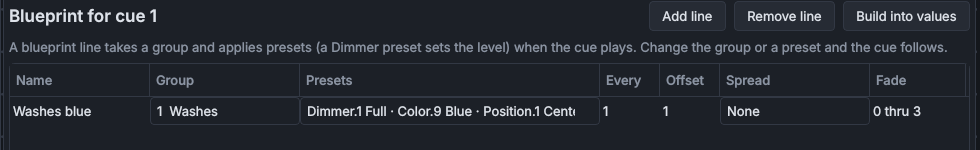

A cue can hold values directly (what you stored from the programmer), or be described by a **blueprint**: a list of lines, each saying "take this group, apply these presets (and effects)". Blueprints are worked out live when the cue plays, so changing a group or a preset changes the cue without storing it again. A cue can have both: its own values override the blueprint.

### Blueprint lines

Select a cue and use the **Blueprint** table under the cue list:

| Column | Meaning |
| --- | --- |
| **Name** | A name for the line. |
| **Group** | The group it applies to. |
| **Presets** | Tap to choose presets: a tab per pool plus **All presets**. Tick a preset's box or tap its name to add it or take it out. Intensity comes from a Dimmer preset (the demo has Full, 25% and Out). |
| **Every**, **Offset** | Take every Nth fixture of the group, starting from this one. |
| **Spread** | A spread from the pool: which of the group's fixtures, and how the line's effects spread across them. |
| **Fixtures** | How many fixtures the line reaches. |

**Add line** adds a line (on the first group, at Full when there's a Full preset); **Remove line** removes the selected one. A line whose group, preset, effect or spread was deleted gets a red dot. It keeps pointing at the old number, so storing a new one there fixes it.

### Build into values

**Build into values** (or `Build Cue 2`) turns a cue's blueprint into ordinary cue values, keeping preset references. Do this when you want to edit fixtures individually.

### Blueprint-only cue lists

Many shows can be programmed entirely in blueprints: lay out empty cues with `Store Cue 1 Thru 40` or **New cue**, then give each a few lines.

```
Blueprint Cue 2 Group 1 Dimmer.1 Color.2
Blueprint Cue 2 Group 1 At 80 Color.2          At 80 adds an 80% universal Dimmer preset
Blueprint Cue 2 Group 1 Every 2 Offset 2 Color.3
Blueprint Cue 4 Group 1 Effect 12 Spread 3
BP Cue 5 Group 2 Position.1 "Spots home"       BP is short for Blueprint
Build Cue 2
```

## Executors and playback {#executors}


Sequences play back on **executors**: on-screen faders, buttons and knobs.

### Executor rows

Executors are numbered by row:

| Numbers | Kind |
| --- | --- |
| **101–199** | Buttons. One key, Go by default. A button always plays at full. |
| **201–299** | Faders. Three keys (Go, GoBack and Off unless you change them) and a fader. |
| **301–399** | Encoders. A knob for the master and a push key (Toggle). |
| **401–499** | Any of the three: right-click → **Executor type**, or `Executor 401 Button` (or `Encoder`, `Fader`). |

The Playback view stacks encoders 301–310 over faders 201–210, with buttons 101–110 underneath.

### Assigning a sequence

- Store onto an empty executor: it gets a new sequence.
- Right-click an executor → **Assign sequence**.
- `Assign Sequence 2 At Executor 202`, or press **Shift+A** (or type `Assign`), tap a sequence, then tap an executor: anywhere on it, not just its title.
- Right-click a sequence in the pool → **Assign to executor…**

**Unassign** (right-click) removes it. Right-click → **Appearance…** sets the sequence's color (see [The sequence pool](#sequences)). The sequence's number shows small and gray beside its name on the executor, like the executor's own number.

### Rate masters {#rate-masters}

Ten **rate masters** set the speed of the effects that follow them. Each works in one of three modes:

| Mode | What the value means |
| --- | --- |
| **Rate** | A multiplier on each effect's own speed. The fader's middle is 100 %, the top 200 %; type up to 1600 %. |
| **BPM** | A tempo: every effect following it runs one cycle per beat, whatever its own speed. |
| **Ratio** | A multiplier in musical steps: ×1/16, ×1/8, ×1/4, ×1/2, ×1 (the middle), ×2, ×4, ×8, ×16. |

- **Make an effect follow one**: in the effect editor, pick it under **Rate master**, or `Assign Effect 3 At RateMaster 2`. An effect following a master ignores its own speed setting in BPM mode; in Rate and Ratio modes the master multiplies it.
- **Put one on an executor**: right-click an executor → **Assign rate master**, or `Assign RateMaster 1 At Executor 210`. Its fader sets the value and its buttons are **Learn** (tap tempo: tap it in time), **Reset** (back to 100 %, 120 BPM or ×1) and **Freeze** (stops every effect following it where it is). Right-click the executor to choose what each key does (Learn, Reset, Freeze or nothing) and the master's **type** (Rate, BPM or Ratio); those choices only show on an executor with a rate master, and a sequence's fader and button functions only on one with a sequence.

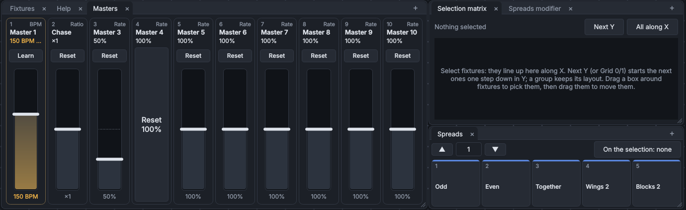


- **The Masters window** (+ → Masters) shows all ten as faders, ten across in one row, drawn like the 200 executors: the name and value at the top, a key, and the fader (the dotted line marks 100 % or ×1). In a new show master 1 is BPM, master 2 a ratio and the rest rates. The key is **Learn** on a BPM master (tap it in time to set the tempo) and **Reset** on the others (back to 100 %, ×1 or 120 BPM); right-click → **Its key** switches it either way. Drag the fader, press the key, and right-click to name it, pick its mode, type a value, reset or freeze it, or give it an **Appearance…** (a color, shown along its top and on executors it's on, as for sequences; `Appearance RateMaster 2 "Blue"`). **Show it as Button** turns that master into one big key instead of a fader (`RateMaster 4 Button`, `RateMaster 4 Fader`).
- **MIDI**: the faders and keys map like executors. Turn on **Learn MIDI** and tap a master's fader or key, then move the control; or right-click it → **MIDI learn: fader** or **MIDI learn: button**. The button does what the key does (Learn or Reset). Faders get pickup like executor faders. **Forget MIDI mappings** removes them; the MIDI tab lists them as **Master 3 Fader** and **Master 3 Key**.
- **On the command line**: `RateMaster 2 At 128` sets it (percent in Rate mode, BPM in BPM mode, the multiplier in Ratio mode); `RateMaster 2` taps it; `Label RateMaster 2 "Chase"` names it.

### One sequence on several executors

A sequence can sit on as many executors as you like, and they play it **together**: it's one playback. Put sequence 1 on 101, 201, 301 and 401, set 301's push to Pause and 401's key to Off (and 201's fader to X-fade), and **Go** on 101 starts it, 301 pauses the fade, 201 crossfades to the next cue by hand, and 401 turns it off. All of them show the same cue. Master faders of the same sequence move together.

### Button functions {#button-functions}

Fader executors have three keys, the others one. Right-click an executor to change what each does, or tap a key after `Assign Flash At` (`Assign Flash At Executor 201 Button 3`):

| Function | Does |
| --- | --- |
| **Go** | Starts the sequence, or goes to the next cue. |
| **GoBack** | Goes to the previous cue. |
| **Pause** | Holds a fade; press again to continue. |
| **Flash** | Full while held, back when released. |
| **Temp** | On while held, at the fader's level. Unlike Flash it uses the times: it comes in with the first cue's fade and goes out with the Off line's fade and delay. With a Temp fader on the sequence, see **Temp** under [Fader functions](#fader-functions). |
| **Toggle** | On, then off. |
| **On** / **Off** | On, or off (with the sequence's off time). |
| **Swop** | Like Flash, and everything else goes dark while held. |
| **Select** | Selects the sequence (for the Sequence editor and Cue commands). |
| **Top** | Back to the first cue. |
| **Goto** | Shows the sequence's cues to pick one: see [Goto](#goto). |
| **Load** | Shows the same list: the cue picked waits for the next **Go**. See [Load](#load). |

### Goto {#goto}

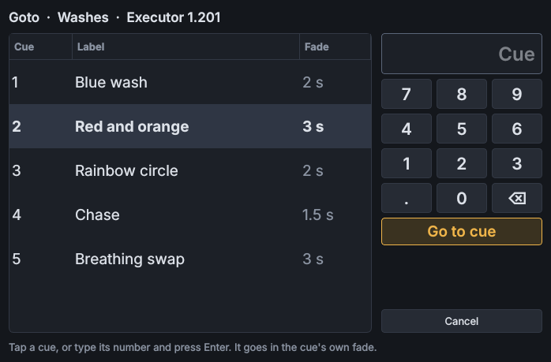

An executor button set to **Goto** (right-click → its button → **Goto**, or `Assign Goto At Executor 201`), or `Goto Executor 201`, opens the sequence's cues in the middle of the screen: number, label and fade, one big row each for touch screens. Tap a cue, or type its number (on the keyboard or the keys beside the list) and press **Enter**: the executor goes to it in the cue's own fade and times. The live cue is marked.

On the command line, `Goto Cue 3 Executor 201` goes straight there, and `Goto Cue 3 Executor 201 Fade 2` takes 2 seconds instead, for every value.

### Load {#load}

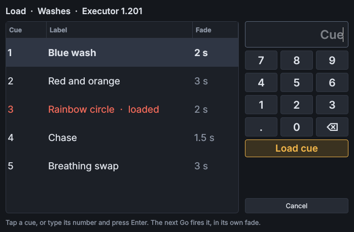

**Load** picks the cue the next **Go** fires, without going there yet. A button set to **Load** (`Assign Load At Executor 201 Button 3`), or `Load Executor 201`, opens the same list as Goto: tap a cue, or type its number and press **Enter**. The loaded cue shows in red on the executor (**Load 3**), in the list, and in the Playback monitor (**Loaded:**). The next Go, from any key, command or macro, fires it in its own fade and times, then the list carries on from there. A loaded cue waits while the playback is off, and is kept with the show.

`Load Cue 3 Executor 201` (or `Load Cue 3 Sequence 5`) loads it straight away; `Load Executor 201 /clear` takes the load back.

### Fader functions {#fader-functions}

| Function | Does |
| --- | --- |
| **Master** | The fader scales the sequence's intensity. Raising it from zero starts the sequence; pulling it to zero stops it. |
| **X-fade** | The fader runs the fade to the next cue by hand. |
| **Temp** | A temporary takeover, by hand. Raising it from zero starts the sequence on its first cue; the fader is the fade: at 30 % every attribute (intensity, color, position, effects…) is 30 % of the way from what's underneath to the cue's value (snapping channels go all the way as soon as it moves). What it covers keeps running underneath: Off when overridden never turns anything off for a Temp fader, nor turns the Temp fader's sequence off. Back at zero the sequence is off and the stage is what was underneath. Moved by hand, the fader is the timing: the cue's fade and the Off line's times aren't used. A **Temp** key on the same sequence always follows the times: held, it takes the sequence all the way in the cue's fade (from wherever the fader had it); let go, it goes out in the Off line's fade and delay, and the fader is back at 0. Moving the fader during that Off fade takes over by hand from there. |

`Assign XFade At Executor 201` sets a fader's function.

### Pages

Executors come in **pages**. Above the executors, the way a pool pages through its slots: **▲** goes to the previous page, the box shows the page number (type a number to jump there; a new number makes a new page), **▼** the next. The page's name sits beside it: double-click or right-click it to name the page, or `Label Page 2 "Verse"`. `Page 2`, `Page +` and `Page -` switch pages from the command line.

**+ → Executor pages** adds a pool of pages: tap one to go there (the current page is lit), right-click to name it.

Each row holds up to **99 executors** per page: 101–199, 201–299, 301–399 and 401–499. **Show → Config… → Executors per row** sets how many an executor window shows by default.

### Off, then tap

Press a playback key with nothing else on the command line (**Off**, the **O** shortcut, or **On**, **Go**, **GoBack**, **Pause**, **Top**, **Goto**, **Load** on the command keys), then tap an executor: it does that to the executor. **O** then a tap on 201 is `Off Executor 201`.

### Playback commands

```
Go Executor 201                go (also GoBack, Off, Pause, Top)
Goto Cue 3 Executor 201        jump to a cue (in its own fade)
Goto Cue 3 Executor 201 Fade 2 jump to it in 2 s
Goto Executor 201              show its cues to pick one
Load Cue 3 Executor 201        the next Go fires cue 3
Load Executor 201              show its cues to pick the one to load
Executor 201 At 75             set a fader
Top Executor 201               back to the first cue
Off Executor 201               off, with the sequence's off time
```

On the keyboard: **Space** is Go and **Shift+Space** is Go Back for the selected sequence; **O** is Off.

### Executor windows

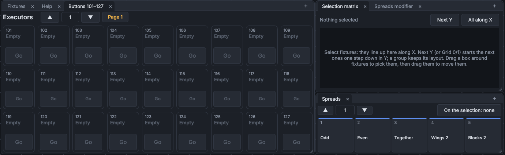

Add an Executors window with **+ → Executors**: one row of executors. **+ → Executor grid** shows them as a grid instead, like a pool: from 101 by default, as many as fit.

Right-click either window's tab to set, like a pool's grid, **Executors wide** and **Executors tall** (0 fits as many as there's room for), and the **Row** (101, 201, 301 or 401) or the **First executor**. A grid runs across, then down, and stops at the end of the row's 99: a grid from 101 that's 10 wide and 3 tall shows 101–130. A grid with a set size (both wide and tall set) fills its window: resize the window and the executors grow or shrink with it. Every executor window has the page control, and they all follow the same page, unless one is locked to a page of its own (see [Window options](#views)).

## Images {#images}

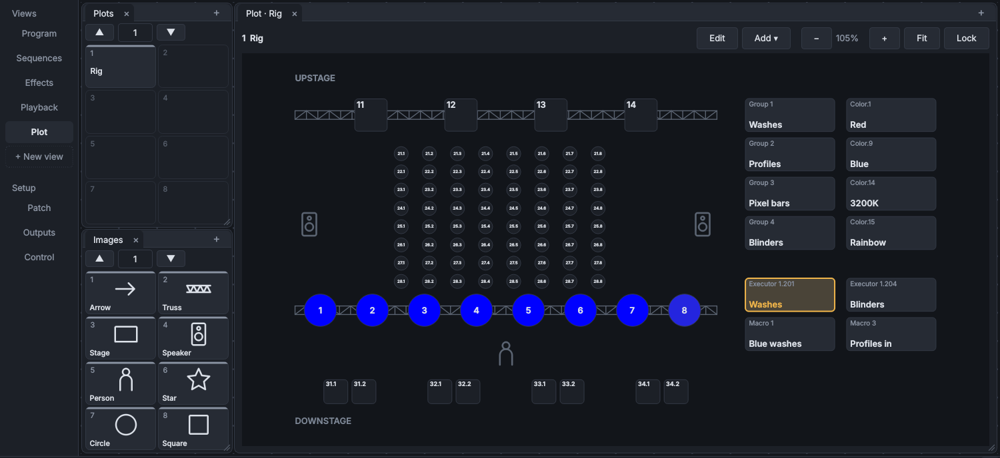

The **image pool** holds the show's pictures: Lumora's own symbols (slots 1–15 in a new show: arrow, truss, stage, speaker, person, star, circle, square, triangle, door, camera, fog, moving wash, moving profile and a conventional profile) and anything you import. They're kept in the show file, so the show has them on any computer. Add the pool with **+ → Images**; the Plot view has it under the plots pool.

- **Import**: tap an empty slot and pick one or more files (SVG, PNG, JPEG, BMP or GIF); they go into that slot and the free ones after it. Or press **Store** and tap a slot, or drop files from your file manager onto the window.
- **Use**: right-click an image to put it on the plot that's showing, or make it that plot's background. From a plot, **Add ▾ → Image from the pool**. On the command line: `Assign Image 16 At Plot 1`.
- **Change**: right-click to rename it (`Label Image 16 "Ground plan"`), **Replace with a file…** (everything using it changes), **Export…** it to a file, or delete it (`Delete Image 16`; plots that used it show it as missing).
- **Move and copy**: `Move Image 16 At 30` (plots follow it to its new number), `Copy Image 16 At 31`.

## Plots {#plots}

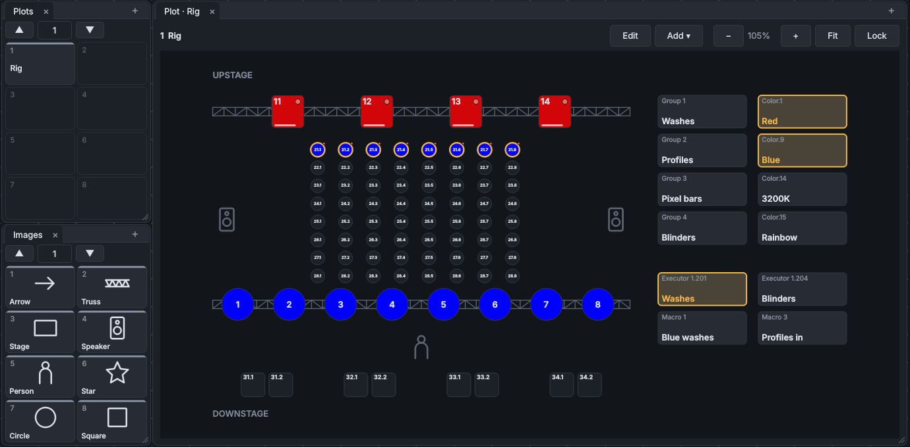

A **plot** is a sheet you lay out to work from: fixtures where they hang, pool objects you use often, and text and pictures to find your way. The **Plot** view in new shows has the **Plots** pool and a **Plot** window side by side (add either with **+ → Plots** or **+ → Plot**).

### Fixtures on a plot

Fixtures and subfixtures show their **intensity and color** live, redrawn whenever the output changes (up to 30 times a second): the symbol lights in the color the fixture is making, as bright as its intensity, with a level bar along the bottom. A selected fixture has a yellow outline; a fixture with values in the programmer has a coral dot in its corner. Pixels and other subfixtures go on as small dots.

- **Tap** a fixture to add it to the selection; tap it again to take it out. The selection keeps the order you tapped in.
- **Drag a box** on an empty part of the sheet to add everything inside it, left to right and top to bottom.
- Commands waiting for a target take the tap, so `Move`, `Copy` and the like work by tapping here too.

### Pool objects on a plot

Groups, presets, sequences, executors, effects, macros, views, spreads, rate masters and other plots can sit on a plot as tiles. Tapping one does what its pool tile does: a group adds its fixtures to the selection, a preset applies, a sequence is selected, an executor goes, an effect runs (or opens in the editor when nothing is selected), a macro runs, a spread goes on the selection, a view or plot is shown. They light up while they're in use: a group that is the selection, a preset in the programmer, a running sequence or macro.

### Putting things on a plot

- **Add ▾ → Selected fixtures** puts them on in a row under what's there (ones already on it are skipped). On the command line: `Assign Fixture 1 Thru 8 At Plot 1`, `Assign Fixture 21.1 Thru 21.8 At Plot 1`, or `Store Fixture 101 Thru 108 At Plot 1` (Store and Assign do the same here). A plot that doesn't exist yet is made.
- **Add ▾ → Pool object…** picks one from a list (tabs for each kind, and a search), or `Assign Group 3 At Plot 1` (or `Store Group 3 At Plot 1`), `Assign Preset 4.1 At Plot 1` (or `Color.1`), `Assign Sequence 2 At Plot 1`, `Assign Executor 1.201 At Plot 1`, and likewise Macro, Effect, View, Spread, RateMaster and Plot.
- **Add ▾ → Text** writes a label.
- **Add ▾ → Image from the pool** puts a picture from the [image pool](#images) on the plot: Lumora's symbols (arrow, truss, stage, speaker, person and so on) or anything imported. **Import a picture into the pool…** brings in a file and puts it on. On the command line: `Assign Image 16 At Plot 1`.
- **Add ▾ → Background → Image from the pool…** puts a picture (an SVG ground plan, say) behind everything, and **Solid color…** colors the whole sheet. A plot has one background: adding another replaces it.

Pictures on a plot are the pool's images, by number: replace Image 16 in the pool and every plot showing it changes. Right-click a picture on the plot to swap it for another from the pool. A picture whose image was deleted from the pool shows as missing until you choose another.

### Editing

Press **Edit** to arrange the plot. Drag things to move them (they snap to a grid), drag a box to pick several, Shift- or Ctrl-click to add to the pick, and drag the small square on a single picked item's corner to resize it. **Delete** removes the picked items. Right-click (or double-click) an item for its settings: a label, a fixture's shape (square or circle), a text's size and color, and a picture's tint (for one-color icons), and **Remove from the plot**. Everything you add sits in front of the background. Press **Edit** again to go back to using it.

The truss icon stretches: drag it longer and it adds sections rather than stretching the ones it has, and make it taller than it is wide to stand it upright.

**Align.** In Edit, **Align ▾** in the top bar lines up what's picked, as in a drawing program: left edges, centers on the vertical axis, right edges, top edges, centers on the horizontal axis, bottom edges. With three or more it also spaces them out: left edges, centers, right edges or tops, middles, bottoms at equal distances, or equal gaps between them across or down (the two outer ones stay put). **Relative to** says what they line up on: the last picked (the default), the first picked, the biggest, the smallest, the picked things taken together, or the whole plot. A group moves as one. Right-clicking a picked item shows the same choices.

**Arrange.** Things drawn later sit on top. Right-click an item for **Bring to front**, **Bring forward** (up one), **Send backward** (down one) and **Send to back**. They act on everything picked when the item is one of them, or on its group.

**Groups.** Pick several items, right-click one and choose **Group these**: from then on, picking any of them picks them all, so they move, arrange and are removed together. **Ungroup** splits them up again. To resize one of them, ungroup first.

**Links.** Text, icons and pictures can stand in for a fixture or a pool object. Right-click one → **Link to a fixture or pool object…** and pick it from the list (below): tabs for fixtures, groups, presets, sequences, executors, effects, macros, masters, spreads, views and plots, and a search (type a name or number, Enter takes the first match). Tapping it then does exactly what tapping that fixture or tile does, and it gets a colored outline while the fixture is selected or the object is in use. **Unlink** makes it plain again. The demo's UPSTAGE label is linked to Group 2.

A link can also be any command line (type it in **Or a command to run**): tapped, it runs. Two kinds also light up: a Goto (`Goto Cue 3 Sequence 12`, or `… Executor 5.216`) while that playback sits on that cue, and a preset copy (`Copy Preset 4.2 At 4.101 /o`) while the target holds what the source does. A picture can show **another picture while it's live** (right-click → **While live, show another picture…**): an outlined swatch that turns filled when its color is on. That makes a color grid: one row of pictures per group, each running `Goto Cue n Sequence s` on a sequence with a cue per color, filled where the color is on; and an effect's two colors chosen by copying color presets into the two presets it uses, the tile of the copied color lit.

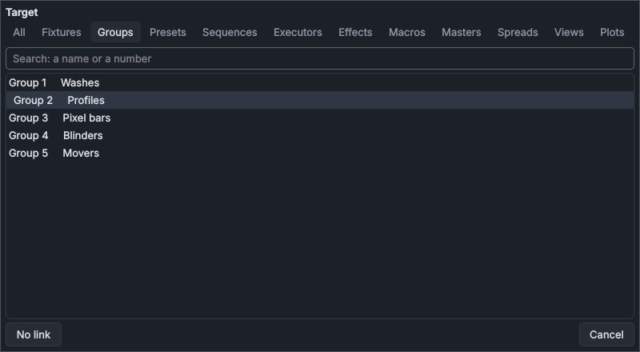

### Zoom

**+** and **−** zoom in and out, **Fit** shows everything, and Ctrl and the wheel zoom round the pointer; the wheel scrolls, and the middle button drags the sheet about. **Lock** fixes the zoom and position: +, −, Fit, the wheel and dragging leave it where it is, which keeps a plot from being knocked out of place during a show.

Each plot window keeps its own zoom, position and lock, for each plot it shows, and the view stores them: recall the view and the plot comes back framed the way it was stored. Two windows can show the same plot at different zooms.

### Right-click and the top bar

Right-click an empty part of the plot for **Edit**, **Add**, **Align** (in Edit), **Background**, **Zoom in**, **Zoom out**, **Fit**, **Lock zoom and position** and **Hide the top bar**. Hiding the top bar (Edit, Add, the zoom buttons) gives the plot the whole window; right-click again to **Show the top bar**. Both are kept with the view, and the window's tab right-click has them too.

**Background** (on that menu and on the window's tab right-click) changes the background image or color, **Fit the image to the plot** sizes the image to what's on it, and **Remove the background** takes it away.

### The Plots pool and commands

Tap a plot in the **Plots** pool to show it in the plot windows (`Plot 2` does the same). A plot window normally shows the plot chosen last; right-click its tab to keep it on one plot. Store and tap an empty slot to make a plot; right-click a tile to rename it, add the selected fixtures, or delete it. On the command line: `Store Plot 2 "Truss"`, `Label Plot 2 "Name"`, `Copy Plot 2 At 3`, `Move Plot 2 At 4`, `Delete Plot 2`.

The demo show has a **Rig** plot of all its fixtures, with its groups, three colors, the wash executor and a macro.

## Macros {#macros}

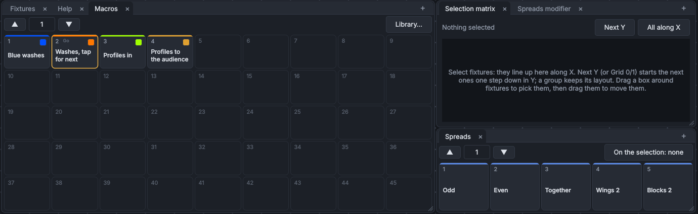

A **macro** is a list of commands that runs line by line: anything you can type on the command line. Add the **Macros** window with **+ → Macros**.

- **Make one**: press **Store** and tap an empty slot (or right-click it → **New macro…**, or type `Store Macro 4 "Name"`). The macro editor opens.
- **Run it**: tap it, or type `Macro 4` (or `Go Macro 4`). A running macro is outlined and shows the line it's on.
- **Stop it**: right-click → **Stop**, or `Off Macro 4`. `Off Macro` stops every macro.
- **Run it from a cue**: give the cue a macro in the cue list's **Macro** column (`Cue 3 Macro 4`); it runs as the cue starts, whichever way it starts.
- **Edit it**: right-click → **Edit lines…**. Right-click also renames it, gives it a **Color…** (or `Appearance Macro 4 "Orange"`), switches it between foreground and background, and deletes it.

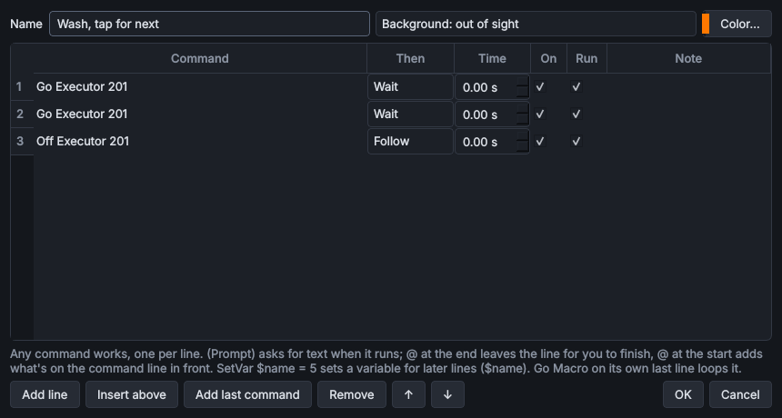

### Lines

| Column | Meaning |
| --- | --- |
| **Command** | The command, as you'd type it. It edits like the command line: with shortcuts off, keywords complete as you type; with shortcuts on, the shortcut keys type their keywords (S Store, G Group, T Thru, A At…), except inside quotes. |
| **Then** | **Follow**: the next line runs after the **Time** (0: straight away). **Wait**: the macro stops there until you tap it again (or `Go Macro 4`); then it goes on from the next line. |
| **Time** | Follow only: seconds before the next line. Tapping the macro during a Follow time goes on at once. |
| **On** | Off: the line is skipped. |
| **Run** | Off: the command is left on the command line for you to finish and press Enter, and the macro goes on. (A background macro runs it anyway.) |
| **Note** | For whoever edits the macro. |

**Add last command** adds the last command from the command history, so you can try a command, then keep it. **↑ ↓** reorder the lines.

### Foreground and background

- **Foreground** (the default): each line shows on the command line as it runs, as if typed, and goes into the command history.
- **Background**: the lines run out of sight, without touching the command line, so you can keep typing while it runs. They still go into the command history, marked with the macro (**BG** on the tile).

In the command history, lines a macro ran show which macro ran them.

### Inside a line

- **(Prompt)**: text in brackets asks for input when the line runs, and what you type takes its place: `Fixture (Which fixtures?) At 50`. Cancelling stops the macro.
- **@ at the end** leaves the line on the command line for you to finish (like Run off): `Store Cue @`.
- **@ at the start** puts what's already on the command line in front of the line: `@ At 100` after typing `Group 2`.
- **Variables**: `SetVar $level = 70` keeps a value; `$level` in any later line (or anything you type) is replaced by it: `Group 1 At $level`. Variables last until Lumora closes.
- **Colors**: `Appearance Sequence 2 "Red"`, `Appearance Macro 4 "#ff8800"` or `Appearance RateMaster 1 "Blue"` recolors a sequence, macro or rate master (`Off` takes the color away). Names are the standard colors: Red, Orange, Yellow, Lime, Green, Sea green, Cyan, Sky blue, Blue, Purple, Magenta, Pink, White.
- **Other macros**: `Go Macro 5` starts macro 5. A macro's own number as its last line (with a Follow time) makes it loop until you stop it.

### The macro library {#macro-library}

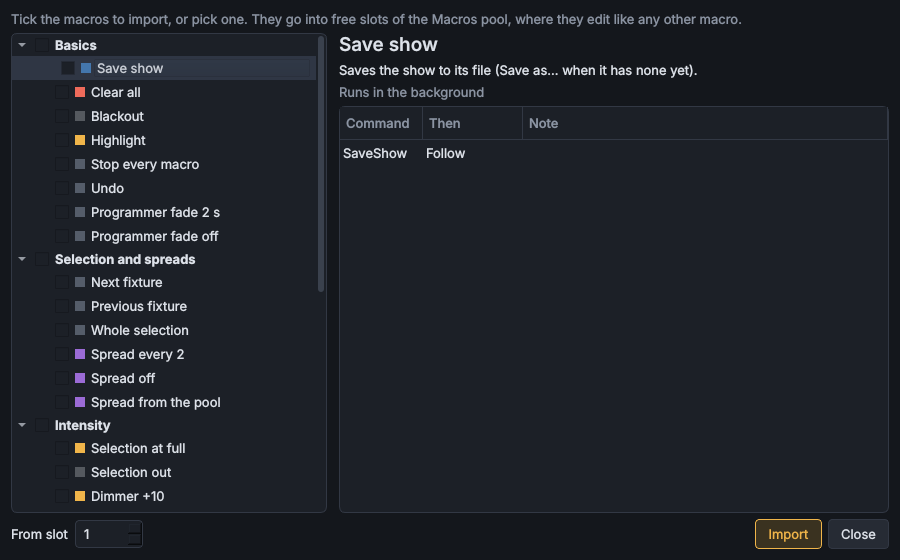

Lumora comes with a library of ready-made macros. Open it with **Library…** in the Macros pool's header, or right-click an empty slot → **From library…**. Pick a macro to see what it does and its lines; tick several (or a whole category) and press **Import**: they go into free slots from the **From slot** number on, and edit like any other macro.

| Category | Macros |
| --- | --- |
| Basics | Save show (`SaveShow`), Clear all, Blackout, Highlight, Stop every macro, Undo, Programmer fade 2 s, Programmer fade off |
| Selection and spreads | Next fixture, Previous fixture, Whole selection, Spread every 2, Spread off, Spread from the pool (asks which) |
| Intensity | Selection at full, Selection out, Dimmer +10, Dimmer -10, Set a level (asks once, kept as `$level`) |
| Position | Pan left and right 10°, Tilt up and down 10° (`Pan +-10`, `Tilt +10`: from where each fixture points), Nudge pan, Nudge tilt, Nudge pan and tilt (ask how far), Center, Pan sweep and Tilt nod (loop until stopped) |
| Playback | Go on an executor, Load a cue, Store next cue (each asks which) |

The demo show has four: **Blue washes** (foreground), **Washes, tap for next** (background, with Waits: tap it to step through executor 201's cues), **Profiles in**, and **Profiles to the audience**, which the Pixel bars cue list's last cue runs.

## Playback monitor {#playback-monitor}

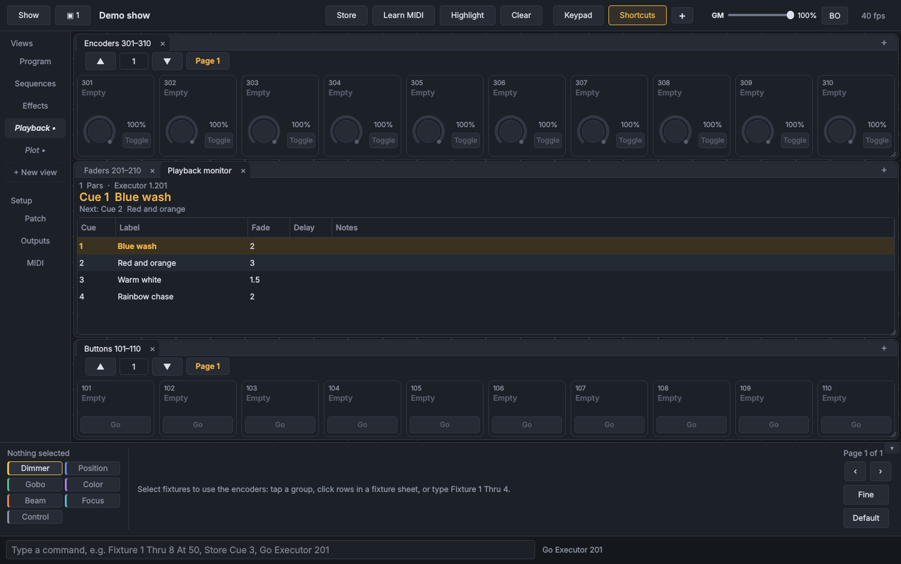

**+ → Playback monitor** shows a cue list as it runs: the live cue lit, the next one marked, and a progress bar while a cue fades in. It follows the sequence the last **Go** went to (from any executor, a Go button, a Follow or the command line), so it shows whatever you just ran; right-click its tab to lock it to one sequence and choose its columns (cue, label, fade, delay, trigger, macro, notes, contents). **Trigger** shows how each cue starts (Go, Wait 5, Follow) and **Macro** the macro it runs. Drag a column heading to reorder them. Double-click or right-click a cell to edit a cue's label, notes, fade or delay, or to go to that cue.

# The workspace

## Views and windows {#views}

### Views

A **view** is a saved layout of windows. The rail lists the show's views; tap one to show it. Views are stored in the show file.

- Change the windows of a view as much as you like. Tapping the view again brings back what was stored. A changed view shows in italics with a dot. Going to a different view drops the changes too: the view you left is back to what was stored, unmarked, so store changes you want to keep before you leave.
- To keep the changes, press **Store** (the views light up red) and tap the view, or right-click it → store the changes, or type `Store View 2`.
- **+ New view** makes an empty view. With Store on, it makes one from the windows on screen.
- Right-click a view to recall, rename or delete it.
- A view also remembers each window's own state: which preset pool tab shows, a pool's scroll position, the fixture sheet's columns and open fixtures, and so on.
- **+ → Views** adds a Views pool window: tap a tile to show that view, or Store and tap a slot.

On the command line: `View 2`, `Store View 5 "Busking"`, `Label View 2 "Name"`, `Move View 2 At 6`, `Copy View 2 At 7`, `Delete View 5`.

### Windows

**+** in the top bar (or a double-click on empty space) adds a window to the current view:

| Window | Shows |
| --- | --- |
| **Color picker** | Gels, colors, temperature and gamut. |
| **Command history** | Every command and edit this session. |
| **Command keys** | The on-screen command keys. |
| **DMX monitor** | 512 channels of a universe. |
| **Effect editor** | One effect's layers and preview. |
| **Effects** | The effects pool and running effects. |
| **Encoders** | Encoders with their own feature and page (see [Encoder windows](#encoders)). |
| **Executor grid** | Executors as a grid, like a pool. |
| **Executor pages** | The executor pages as a pool. |
| **Executors** | A row of executors. |
| **Fixtures** | The fixture sheet (table or tiles). |
| **Groups** | The groups pool. |
| **Park** | Parked fixtures and attributes. |
| **Patch**, **DMX outputs**, **Control (MIDI and OSC)** | The setup screens as windows. |
| **Playback monitor** | A running cue list: the last one started with Go. |
| **Macros** | The macro pool. |
| **Plot** | One plot: fixtures live, pool objects to tap, text and pictures. |
| **Plots** | The plot pool. |
| **Presets** | A preset pool, with tabs for each feature. |
| **Masters** | The ten [rate masters](#rate-masters) (Rate, BPM and Ratio). |
| **Help** | This guide, with a search. |
| **Images** | The image pool (see [Images](#images)). |
| **Sequence editor** | The selected sequence's cues and blueprint. |
| **Selection matrix** | The selected fixtures laid out X and Y (see [Selection matrix](#selection-matrix)). |
| **Sequences** | The sequence pool. |
| **Spreads** | The spreads pool and the active spreads. |
| **Spreads modifier** | The X and Y spreads on the selection, to change live (see [Spreads modifier](#spread-modifier)). |
| **Views** | The views as a pool. |

They're listed alphabetically, here and in the **+** menus.

### Arranging windows

Windows sit on a grid, and never overlap. Drag a window's header to move it; drag an edge or corner to resize it. Every window is a stack of tabs: drag a tab onto another window to stack it there, or onto empty space to give it a window of its own. A window's tab says what it shows ("Dimmer presets", "Faders 201–210", "Sequence editor · Washes").

### Window options

Right-click a window's tab for its options:

- **Pools** (groups, presets, effects, spreads, views, sequences): **Grid** sets tiles wide × tall (0 × 0 fits as many as there's room for), the **tile size**, and **Lock position**. The top left of every pool has ▲, the slot in the top-left corner (type a number to jump there), and ▼. Scrolling moves a row at a time. A locked pool stays where it is and hides that whole bar (with the preset pool's type tabs), so the window is all tiles.
- **Fixtures**: **Table** or **Tiles** layout, and which fixtures to show (all, patched, selected, or in the programmer).
- **Executors** and **Executor grid**: executors wide × tall, which row or first executor, and **Locked to page**: a page of its own (0 follows the current page). A locked window shows that page whatever page the rest go to and its MIDI mappings act on that page. It has no page bar: its tab has a lock and says the page ("Faders 201–210 · Busking", or "· Page 3" when the page has no name).
- **Playback monitor**: sequence (or follow the last Go), columns, banner.

Options are saved per window, so two windows of the same kind can look different.

## The fixture sheet {#fixture-sheet}

The **Fixtures** window lists every fixture with its current values by feature: ID, Name, Patch (address), Dimmer, Position, Gobo, Color, Beam, Focus and Control.

- **Coral** values are in the programmer; white values are away from their default; gray values are at rest.
- Values show as **preset names** wherever they come from a preset, in the programmer or from a running cue. While a cue is fading, or a master pulls the level down, you see the number instead.
- **Effects show by name** the same way, in the feature they move: a dimmer chase reads "Chase" in the Dimmer column, and an effect over a preset reads "Blue · Rainbow". Effects from the programmer and from running cues both show.
- **Tap rows** to add fixtures to the selection; tap again to take them out.
- **Drag a column heading** to reorder columns; drag the line at a heading's right edge to resize. The order is kept with the view.
- **Subfixtures** nest under their fixture with an arrow (see [Subfixtures](#subfixtures)).

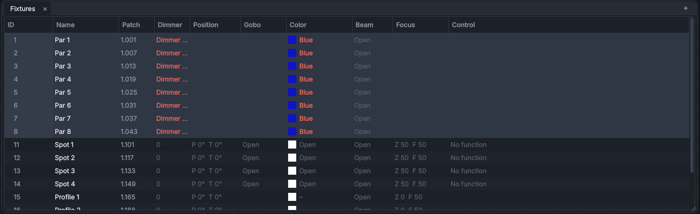
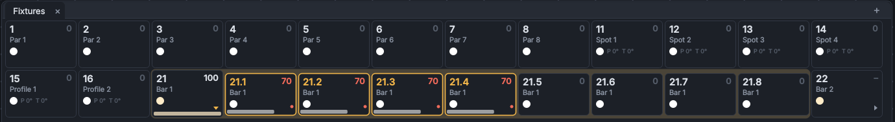

- **Tiles** layout (right-click the tab) shows each fixture as a tile with its level, color, gobo and position. Fixtures with subfixtures get an arrow in the corner; open one and its cells sit with it on a tray, smaller, so they read as one fixture.

## Screens {#screens}

The **▣ 1** button at the far right of the top bar opens screens 1–6. Pick a number to open another Lumora window (to put on a second monitor) or bring it to the front. Every screen shows the show's views by itself, so screen 2 can show Playback while screen 1 shows Program. The setup pages, encoder bar and show menu live on screen 1, and closing screen 1 closes the others. Without the encoder bar, screens 2–6 have four more rows of window grid (20 instead of 16), so a view made there has room for more windows; on screen 1 a view taller than 16 rows is squeezed to fit. Screens that were open reopen next time. Keys go to the command line of the screen in front.

## Undo {#undo}

**Ctrl+Z** undoes, **Ctrl+Y** (or **Ctrl+Shift+Z**) redoes.

- **Anywhere but a plot**, Ctrl+Z takes back the last command or edit: `Fixture 1 At 50`, a store, a delete, a rename, a move in a pool, an edit in a window. Everything one command changed comes back in one step. Turning an encoder or dragging a value makes one step, not hundreds. What's running isn't undone: cue lists keep playing, faders stay where they are, and the page doesn't change.
- **With the pointer over a plot**, Ctrl+Z takes back the plot's last edit instead (moving, adding, resizing, deleting), and only that. Plots keep their own steps.
- While you're typing on the command line, Ctrl+Z undoes the typing first; once there's nothing typed to take back, it undoes the show.
- On the command line or in a macro: `Undo` (or `Oops`) and `Redo`. Over OSC: `/undo` and `/redo`.

The command line says what was undone ("Undone: Store Cue 3"). Up to 100 steps are kept; opening or starting a show clears them.

## Command history {#history}

**+ → Command history** lists every command run this session (typed, keyed or tapped) with its result, and the edits made in windows (stores, renames and so on). Double-click a command to put it back on the command line; right-click to run it again or copy lines. Its tab options filter it to commands or edits.

## Config {#interface}

**Show → Config…** sets:

- **Interface size**, bigger for touch screens. This one is kept on the computer and takes effect when Lumora next starts.
- **Executors per row**: how many an executor window shows by default (up to 99).
- **Encoders per page** of the encoder bar (five unless you change it; fewer show when they don't fit).
- [Programmer fade](#prog-fade): on or off, and its time.
- **New cues: fade** and **delay**: the times a newly stored cue gets (2 s and 0 s unless you change them). Cues already stored keep theirs.

All but the interface size are saved with the show.

# Reference

## Command line reference {#command-reference}

### How commands work

- Keywords are case-insensitive, and common abbreviations work: `F` (Fixture), `G` (Group), `T` (Thru), `P` (Preset), `Seq`, `Exec`, `@` (At), `BP` (Blueprint).
- A bare number means Fixture: `5 At 50`.
- Presets are written by pool name: `Color.3`, `Position.12`, `All.2` (or `Preset 4.3`).
- Names go in double quotes: `Store Group 3 "Front"`.
- Options start with a slash: `/overwrite`, `/universal`, `/global`, `/selective`.

### Selection

```
Fixture 1 Thru 10 - 5           select 1 to 10 without 5
1 + 3 + 5                       several fixtures
Group 2                         a group (adds to the selection)
Fixture 101.3                   a subfixture (also Fixture 101 Cell 3)
Fixture 101.1 Thru 8            cells 1 to 8 of fixture 101
Fixture 101 Thru 104 Cell 2     cell 2 of each
Fixture 101.1.1 Thru 101.4.1    the first part of every head
Clear / ClearAll                deselect, then empty the programmer / both
Next / Prev                     one fixture of the selection at a time (Page Down / Up)
All                             the whole selection again
Last                            the selection before the last Clear (Ctrl+L)
Highlight                       toggle highlight
```

### Values

```
At 50                           intensity
At Full / At Zero / At At       full, zero, full
At Color.3                      apply a preset (also just Color.3)
Attribute Zoom At 30            any attribute, in its own values (% or its range)
Attribute Pan At -90            pan and tilt in degrees
Fixture 5 Pan 45                select and set in one go
Pan +10 / Tilt +-10 / At +10    up or down from where each fixture is
Flip                            same direction from the other side
Default / Default All           defaults into the programmer
Remove                          drop the selection's values
```

### Park

```
Park                            everything on the selection
Fixture 101 Park                fixture 101 (also Park Fixture 101, 101 Park)
Fixture 101 Intensity Park      one feature: Intensity, Position, Gobo, Color…
Attribute Pan Park              one attribute of the selection
Park Group 2 Position           position of a group
Unpark Fixture 101              the same forms let go
Unpark All                      everything
```

### Storing and editing

```
Store Group 3 "Front"
Store Color.1 "Red" /overwrite
Store Color.3 /selective        store one layer
Store Cue 5 / Store Cue 1 Thru 40 / Store Sequence 2 Cue 1.5
Store Group 3 /merge            onto one that exists: /overwrite, /merge, /remove
Store Color.1 /global           a preset: /overwrite, /global, /selective, /remove
Store Sequence 2 /new           one cue: /overwrite, /merge, /new, /remove
Store Default [/overwrite] / Delete Default
Store View 5 "Busking"
Store Spread 3 "Evens"
Update / Update Cue 3 / Update Color.1
Label Color.1 "Deep red"        also Group, Sequence, Cue, Fixture, Page, View, Effect, Spread
Label Group 3                   no name: a dialog asks for one
Label                           name the selected fixtures (numbered on)
Delete Cue 3 / Delete Group 2 / Delete Color.1 / Delete Spread 3
Copy Group 1 At 5 / Move Color.1 At Color.9 / Copy Cue 2 At 5 / Move Sequence 1 At 4
Copy Color.1 Thru 10 At Color.15  a run of presets (Move too; Thru Color.10 works as well)
```

### Cues and blueprints

```
Cue 3 Fade 4 / Cue 3 Delay 1
Cue 3 Fade 0 Thru 5 / Cue 3 Delay Off      individual times across the cue's fixtures
Fixture 1 Thru 8 At 100 Fade 0 Thru 4      a value with individual fades
Fade 0 Thru 4 / Delay 0 Thru 2 Thru 0 / Time 3 / Fade Off
Cue 3 Note "Wait for the actor"
Blueprint Cue 2 Group 1 Dimmer.1 Color.2
Blueprint Cue 2 Group 1 At 80 Color.2 Every 2 Offset 2 Spread 3 Effect 12 "Name"
Build Cue 2
Remove Fixture 3 Thru 5 Cue 2
```

### Playback

```
Go Executor 201 / GoBack Executor 201 / Off Executor 201 / Pause Executor 201
Top Executor 201
Goto Cue 3 Executor 201 / Goto Executor 201
Load Cue 3 Executor 201 / Load Executor 201
Executor 201 At 75
Assign Sequence 2 At Executor 202
Assign Flash At Executor 201
Assign XFade At Executor 201
Executor 401 Button             also Encoder, Fader
Page 2 / Page + / Page -
Label Page 2 "Verse"
Blackout
```

### Effects and spreads

```
Effect 12                       run on the selection
Effect 12 Rate 150 Size 50      adjust (percent)
Effect 12 Off / Effect Off
Spread 3 / Spread Off
Spread X Every 2 / Spread Y Every 2 / Spread X Off
Spread Every 2 Offset 2 Blocks 2 Groups 4 Wings 2
Spread Phase -360 Thru 0 Direction Backward
RateMaster 2 At 128             set a rate master (%, BPM or ratio)
RateMaster 2                    tap its tempo
Assign RateMaster 1 At Executor 210
Assign Effect 3 At RateMaster 2
Label RateMaster 2 "Chase"
RateMaster 4 Button / RateMaster 4 Fader
```

### Images, undo, selection matrix, programmer fade, OSC

```
Assign Image 16 At Plot 1                 a picture from the image pool on a plot
Label Image 16 "Ground plan" / Delete Image 16 / Move Image 16 At 30
Fixture 1 Thru 4 NextY Fixture 5 Thru 8   two rows of four
Fixture 5 Grid 3/1                        fixture 5 at X 3, Y 1
Grid 2/1                                  next selected fixture goes at X 2, Y 1
Grid 0/0 Thru 3/1                         lay the selection out over that area
ProgFade 3 / ProgFade On / ProgFade Off   programmer fade
Undo / Redo                               the last command or edit (Ctrl+Z, Ctrl+Y)
SendOSC 1 "/address,i,50"                 send OSC on line 1
```

### Plots

```
Plot 2                                       show it in the plot windows
Store Plot 2 "Truss" / Label Plot 2 "Name" / Copy Plot 2 At 3 / Move Plot 2 At 4 / Delete Plot 2
Assign Fixture 1 Thru 8 At Plot 2            fixtures and subfixtures (21.1 Thru 21.8)
Store Fixture 1 Thru 5 At Plot 3             the same as Assign
Assign Group 3 At Plot 2                     or Preset 4.1, Sequence 2, Executor 1.201, Macro 1, Effect 5…
Store Group 3 At Plot 2                      the same as Assign
```

### Macros

```
Macro 3 / Go Macro 3            run it, or go on from a Wait
Off Macro 3 / Off Macro         stop it, or all of them
Store Macro 3 "Name" / Label Macro 3 "Name" / Copy Macro 3 At 5 / Move Macro 3 At 5 / Delete Macro 3
Appearance Macro 3 "Orange" / Appearance Sequence 2 "#ff0000" / Appearance RateMaster 1 "Blue" / Appearance Macro 3 Off
SetVar $name = 50               then $name in any command
SaveShow                        save the show (as Ctrl+S)
```

### Views

```
View 2 / Store View 2 / Label View 2 "Name" / Move View 2 At 6 / Copy View 2 At 7 / Delete View 5
```

### Tapping to finish a command

Commands can finish by tapping. Press **Move**, tap a preset, then tap the slot it should go to. The same works for **Copy**, **Delete**, **Update**, **Remove**, **Label** (asks for the name) and **Assign** (tap a sequence, then an executor). Type `Assign Flash At` and tap an executor's button to give that button the function, or tap its fader or knob for a fader function. Moving something keeps the cues, blueprints and effects that use it pointing at it.

## Keyboard shortcuts and the command keys {#shortcuts}

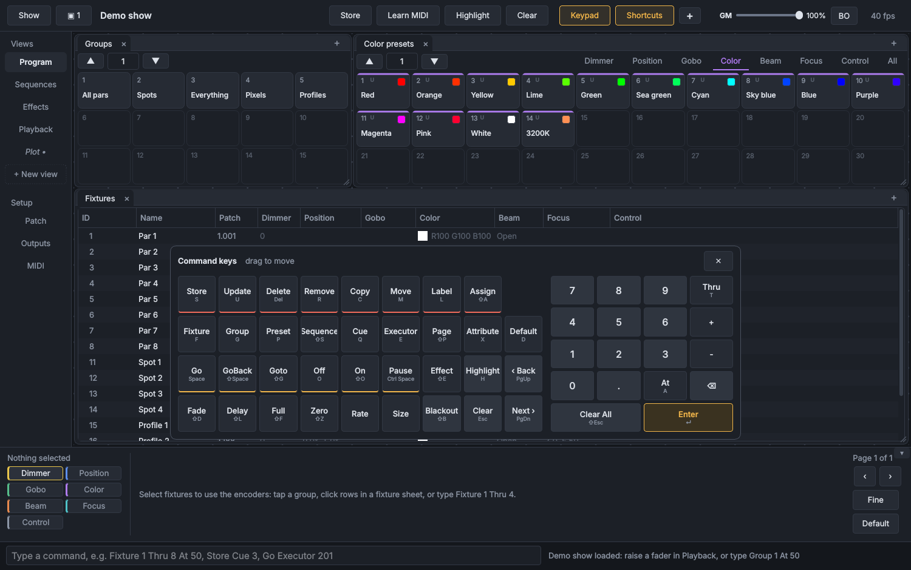

**Keypad** (**Ctrl+K**) floats the on-screen command keys over the view; **+ → Command keys** puts them in a view as a regular window. Every key shows its keyboard shortcut underneath.

| Key | Does | Key | Does |
| --- | --- | --- | --- |
| **S** | Store | **G** | Group |
| **U** | Update | **P** | Preset |
| **Del** | Delete | **Shift+S** | Sequence |
| **R** | Remove | **Q** | Cue |
| **C** | Copy | **E** | Executor |
| **M** | Move | **Shift+P** | Page |
| **L** | Label | **Shift+E** | Effect |
| **Shift+A** | Assign | **Space** | Go |
| **F** | Fixture | **Shift+Space** | Go Back |
| **T** | Thru | **Shift+G** | Goto |
| **A** | At | **O** | Off |
| **Shift+F** | Full | **H** | Highlight |
| **Shift+Z** | Zero | **Shift+B** | Blackout |
| **D** | Default | **Esc** | Clear |
| **Enter** | Run the command | **Shift+Esc** | Clear All |
| **Backspace** | Delete a word or digit | **F1** | Help (this guide, searchable) |
| **Page Down** | Next fixture of the selection | **Page Up** | Back a fixture |
| **Alt+D** | `Dimmer.` (type the number next) | **Alt+P** | `Position.` |
| **Alt+G** | `Gobo.` | **Alt+C** | `Color.` |
| **Alt+B** | `Beam.` | **Alt+F** | `Focus.` |
| **Alt+O** | `Control.` | **Alt+A** | `All.` |
| **Ctrl+L** | Select last | **Ctrl+Z** | [Undo](#undo) |
| **Ctrl+Y** | Redo | **Ctrl+K** | Command keys |

The Alt keys put a preset pool on the command line ready for its number, so **Alt+C** then **3** is `Color.3`; they work while you're typing a command too. Digits, `.`, `+` and `-` type themselves. Shortcuts pause while you're typing in a text field (naming something, typing a command, a number box), and **Insert** turns them on and off; the **Shortcuts** button in the top bar shows which. Tapping anything that isn't a text field ends typing so shortcuts work again.

## Show files {#show-files}

**Show → New show**, **New demo show**, **Open…**, **Save** and **Save as…** manage shows. Shows are saved in the **Lumora** folder in your **Documents** (Lumora makes it), named after the show, unless you pick somewhere else; **Open…** starts there too. The show takes its file's name: **Save as…** with a new name (from the demo show too) renames it, and the top bar shows it. A show is a single file holding everything about the show:

- The patch and every fixture type it uses (so it opens the same on any computer).
- Groups, presets, spreads, sequences, cues, blueprints, effects, shapes, macros, plots and images.
- Executors, pages and their names, and rate masters.
- What's playing: running cues, fades partway through and effects in their cycles carry on when the show opens. Loaded cues and parked attributes too.
- Views, each window's state, and the view on each screen.
- MIDI mappings, executors per row, encoders per page, new cue times, programmer fade, and whether keyboard shortcuts are on.
- Stored defaults.

Lumora keeps only this on the computer itself:

- **DMX outputs and their network interface**: the outputs and the defaults for new universes.
- **OSC lines**: their ports, addresses, prefixes and switches.
- **Window placement and screens**, and the interface size, since these depend on the monitors.
- **The last show**, so it reopens at startup.
- **Fixture library details**: your GDTF Share user name and the downloaded-file cache.

Shows saved by older versions of Lumora open in newer ones and are brought up to date when they're opened (pan and tilt values become degrees, recipe lines become blueprint lines, pictures on plots move into the image pool with Lumora's symbols, and so on).

## Troubleshooting {#troubleshooting}

### The lights don't respond

1. **Is anything being sent?** Open **Outputs** and look at the **DMX monitor** for the universe. If the channels move when you set values, Lumora is sending.
2. **Is the output on**, on the right network card, and sending as the universe your node expects? Try the other *Art-Net 0 / Art-Net 1* setting.
3. **Grand master and blackout**: GM at 100% and BO off.
4. **Address and mode**: the fixture's address and mode (set on the fixture) must match the patch.
5. **Intensity**: moving heads and many LEDs need their dimmer *and* their shutter open. Check the Beam encoders.

### A moving head goes the wrong way

Tick **Invert pan** or **Invert tilt** in the patch.

### Colors look wrong

Check the fixture's mode, and whether it has a dimmer channel. RGB fixtures without one get a virtual dimmer: raise intensity as well as the color.

### Lumora doesn't start, or the installer won't run

Run the installer again and choose **Repair**, or uninstall Lumora and install it again; your shows and settings are kept. If Windows blocks the installer, click **More info**, then **Run anyway**.

### My MIDI controller isn't seen

Plug it in, then press **Rescan devices** on the MIDI tab. Check **Incoming** while moving a control. Make sure no other program has the device open.

### Something in a cue disappeared

A cue or blueprint line with a red or orange dot uses a group, preset, effect or spread that was deleted. Hover over the dot for details; store a new one at the same number to fix it.

## Glossary {#glossary}

| Term | Meaning |
| --- | --- |
| **Attribute** | One controllable property of a fixture: Dimmer, Pan, Red, Gobo1, Zoom… |
| **Blueprint** | A cue's description as lines of "this group, these presets", worked out live. |
| **Build** | Turning a cue's blueprint into ordinary cue values. |
| **Cell** | A subfixture of a pixel fixture. |
| **Cue** | A stored look, with fade and delay times. |
| **Default** | Where an attribute rests when nothing plays. |
| **Effect** | Values that move by themselves: chases, waves, circles. |
| **Executor** | An on-screen (or MIDI) fader, button or knob that plays a sequence. |
| **Feature** | A family of attributes: Dimmer, Position, Gobo, Color, Beam, Focus, Control. |
| **Fixture type** | The description of a fixture's channels (a profile or personality). |
| **GDTF** | General Device Type Format, a standard fixture file format. |
| **Group** | A stored selection of fixtures. |
| **HTP** | Highest takes precedence: how intensity combines among HTP-priority sequences. |
| **Image pool** | The show's pictures, numbered like any pool, for plots. |
| **Individual times** | Fade and delay times of their own on some values of a cue, spread across the fixtures. |
| **Load** | Picking the cue the next Go fires, without going there yet. |
| **LTP** | Latest takes precedence: the default priority, for every attribute. |
| **Macro** | A list of commands that runs line by line, with Follow times or Waits for a tap. |
| **Off when overridden** | A sequence turns itself off once others have taken all its values. |
| **OSC** | Open Sound Control: messages over the network, from apps and other systems. |
| **Park** | Holding attributes at their current output, over everything else. |
| **Patch** | Which fixture is at which DMX address. |
| **Plot** | A sheet with fixtures showing their intensity and color, pool objects to tap, text and pictures. |
| **Preset** | Named, referenced values for one feature. |
| **Priority** | Low, LTP, HTP or Ultra: which sequence wins. |
| **Programmer** | The values you're working on, on top of everything. |
| **Programmer fade** | A time for programmer changes to fade in, instead of snapping. |
| **Rate master** | A master that sets the speed of the effects following it: a rate, a tempo (BPM) or a ratio. |
| **Selection** | The fixtures you're about to change. |
| **Selection matrix** | Where each selected fixture sits, X across and Y down, for effects and spreads. |
| **Sequence** | A list of cues. |
| **Spread** | How a selection is thinned and how effects roll across it. |
| **Subfixture** | A part of a fixture with its own ID: a pixel, a head, a head's beam. |
| **Tracking** | Cues store only changes; values carry on until changed. |
| **View** | A saved layout of windows. |
| **Virtual channel** | A channel that's programmed but not sent as DMX, such as a virtual dimmer. |

## What's new {#whats-new}

### a.7.2.3

**Programming**

- **Relative values**: `Pan +10`, `Tilt +-10`, `Fixture 1 Thru 4 Zoom +5`, `At +10` move each fixture up or down from where it is, for any attribute. Attributes can also be set by name: `Fixture 5 Pan 45`, `Zoom 30`.
- **Storing onto something that exists asks** what to do, always in the same order: **Overwrite**, **Merge** (for a preset **Merge global** or **Merge selective**), **Add Cue 2** for a sequence with one cue, **Remove**, or **Cancel**. A sequence with more cues still takes its next cue, and `/overwrite`, `/merge`, `/global`, `/selective`, `/new` and `/remove` answer ahead on the command line. See [Storing onto something that exists](#store-existing).
- **Macro library**: ready-made macros to import, from saving the show (`SaveShow`, new) and clearing to relative pan and tilt nudges and loops. See [The macro library](#macro-library).
- **Snap** in the fixture editor: a tick box per channel; a snapping channel jumps instead of fading through the values in between. On by default for gobo and color wheels and macros.
- Effect steps' colors are picked in the full color picker (gels, standard colors, temperatures and the gamut).

**Playback**

- **Temp faders** are a real temporary takeover: every attribute, effects included, goes from what's underneath to the sequence's values as far as the fader is up, by hand, and what's underneath keeps running and comes back at zero. A **Temp key** on the same sequence follows the times: in with the cue's fade while held, out with the Off line's times when let go (the fader goes back to 0). See [Fader functions](#fader-functions).
- **Load**: a key function and `Load Executor 201` open the Goto list to pick the cue the next Go fires (`Load Cue 3 Executor 201` directly). The executor, the list and the Playback monitor show what's loaded. See [Load](#load).
- **Playbacks are saved with the show**: what's running when you save carries on where it was when the show opens: the cue, a fade partway through, effects in their cycles, a loaded cue.
- **Playback by sequence number**: `Goto Cue 3 Sequence 5`, `Go Sequence 5`, `Off Sequence 5` (the executor it's on), and `Cue 1 Thru 14 Sequence 5 Fade 3` sets the fade (or delay, trigger, macro) of a run of cues at once.
- **Rate masters on executors**: right-click to choose what each key does (Learn, Reset, Freeze or nothing) and the master's type (Rate, BPM or Ratio).
- **Effects crossfade**: one effect-only sequence taking over from another fades between the effects instead of through the rest values (white).
- **Off when overridden** works between **Low** sequences (two Low color effects replace each other), and a sequence turns off only once the cue that overrode it has finished its fade.
- **Flash and Temp** keys let go again (they stayed on as if Go had been pressed).

**Plots and the workspace**

- **Image pool**: the show's pictures, numbered like any pool: Lumora's symbols and anything you import. Plots place them by number, so replacing one changes it everywhere. See [Images](#images).
- **Plot pictures that light up**: a picture can show a second picture while what it's linked to is live, and a link can be any command line. See [Plots](#plots).
- **Executor appearance: Follow fixtures**: the executor takes the color its fixtures show on stage (`Appearance Sequence 2 Follow`).
- **Locked windows**: an executor window locked to a page (right-click its tab → **Locked to page**) shows a lock and the page's name on its tab instead of a page bar, and a locked pool hides its header bar.
- **Window tabs** squeeze in a narrow window instead of sliding out of sight.
- **Loading screen**: the logo, a progress bar and what's loading right now.

**Faster on modest computers**

- Starting takes about a third less time and about 15 % less memory, and with cues and effects running the Playback and Plot views use about half the processor time. Live windows (the plot, encoders, executors, the fixture sheet) redraw only what changed, up to 30 times a second, and windows out of sight catch up when they're shown.

**Also fixed**

- The **Preset builder** crashed on **Add color temperatures** (and gels).
- The effect editor jumped to the top when a step changed from a color to a preset.
- **Show → Config** has shorter fields, with the Programmer fade tick box beside its time.
